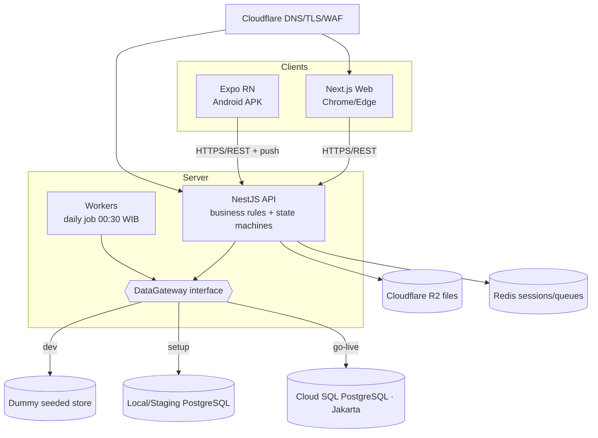

# design.md
> BMI Stooring System — Version 1.0 — 2026-10-30

> Governed by `requirements.md` (this folder) and the authoritative `PRD.md` (SDD Spec v2) at the repo root. `PRD.md` §9 is the final PostgreSQL schema; `DESIGN.md` is the binding visual design system. **Design artifacts in `Design Artifact/` are example mockups of behaviour, not a strict front-end contract** — implement to the requirements and `DESIGN.md`, using each artboard as an illustrative reference only.

## Overview

A TypeScript monorepo. One NestJS API server owns all business rules, the state machines (PRD §3) and the database; the Next.js web app and the Expo/React Native Android app are clients that reach data **only through the API** (NFR-18, DEC-66). PostgreSQL is the system of record; Cloudflare R2 holds files; Redis backs jobs/queues and sessions. A daily job (00:30 WIB) runs document/PM/alert/schedule recomputation (NFR-12, NFR-14).

The engine is **data-driven**: assignment modules (Stock, Part Purchase, Mechanic Action, Mobilisasi, Part Replacement, Document, Part Check), WO presets, vehicle classes, chassis layouts, tyre statuses, document types and alert rules are master data, so a new module or unit type is added without touching engine, designer, WO-document, scope-lock or permission code (PR-6, REQ-REG-006). Mobilisasi is one such registered assignment module (master data, added with no engine change).

**Stack**: TypeScript monorepo (pnpm/turbo) · NestJS API · Next.js (App Router) web · Expo React Native (Android APK) · PostgreSQL · Redis · Cloudflare R2 (S3-compatible). (DEC-66)
**Deployment**: Google Cloud, Jakarta region — Cloud Run (API, workers, web), Cloud SQL (PostgreSQL), Memorystore (Redis), Secret Manager; Cloudflare R2 for files; Cloudflare DNS/TLS/WAF in front. Android APK distributed signed, outside the Play Store. (DEC-67, NFR-18)

### Phased database strategy (maps to the three implementation phases)

- **Dev phase — dummy database (local MVP).** Run the full stack locally against an **in-memory / seeded dummy data layer** behind a repository interface (a thin `DataGateway` the services depend on, not raw SQL). This lets every feature and flow be exercised end-to-end without a real Postgres, so the team validates behaviour and the state machines early. A local Postgres via Docker Compose is optional here but not required; the dummy gateway is the default. No cloud.
- **Setup phase — real local/staging Postgres.** Swap the `DataGateway` implementation to the real PostgreSQL schema (PRD §9) on a local/staging Postgres (Docker Compose or a staging Cloud SQL). All P0 requirements are completed and wired to the real schema; this is where integration tests, debugging and UAT happen. Minor adjustments to schema/UX are still allowed here.
- **Go-live phase — production database & deploy.** The real schema on Cloud SQL (Jakarta), migrations locked, backups/PITR configured and a restore drill passed (NFR-17), secrets in Secret Manager, R2 + Cloudflare in front. Everything (API, DB, web, APK) must be fully working; no behavioural change beyond fixes.

The **repository/`DataGateway` interface is the seam** that makes this phasing clean: services and business rules are written once against the interface; only the backing implementation changes (dummy → local Postgres → Cloud SQL). This is a hard design rule — business logic must never import a concrete DB driver directly.

## Architecture

### System Diagram



## Data Models

The complete, final schema is **PRD §9** (PostgreSQL syntax, dependency-ordered, every decision applied — do not re-derive). Summary of the aggregate roots and their main tables (PRD §3.1):

| Aggregate | Main tables (PRD §9) | Area |
|---|---|---|
| User & role | `users`, `user_roles`, `role_permissions` | IAM |
| Vehicle | `vehicles` (derived status now includes **OFF** — see note below), `vehicle_classes`, `chassis_layouts`, `odometer_logs` | VEH |
| Vehicle document | `document_types`, `vehicle_documents`, `document_renewals`, `document_corrections` | DOC |
| WO preset / module | `wo_presets`, `wo_preset_steps`, `assignment_modules` | REG |
| Work Order | `work_orders` (carries `finding_note`, and now `off_days` + `off_last_counted_date` — see notes below), `work_order_approvals` | WO |
| Step | `work_order_assignments`, `step_time_events`, `step_time_corrections`, `mobilisation_location_trail` | ENG |
| WO content | `work_order_parts`, `work_order_services`, `work_order_purchases`, `work_order_purchase_lines`, `wo_attachments` | STK/MEC/PUR |
| Change request | `wo_change_requests` | CR |
| Parts & warehouse | `parts_catalog`, `stock_cards`, `goods_receipts`, `gr_corrections`, `goods_issues`, `goods_issue_items`, `stock_adjustments` | INV |
| Tyres | `tyres`, `tyre_statuses`, `tyre_events`, `tyre_receipts`, `retread_orders`, `tyre_counts` | TYR |
| Placement | `part_positions`, `part_placements`, `part_placement_logs`, `placement_map_snapshots` | PLC |
| Part items | `part_item_types`, `vehicle_part_items`, `early_failure_events` | BSL |
| Alerts & PM | `maintenance_alerts`, `pm_packages`, `pm_tasks`, `vehicle_pm_schedule`, `dvir_logs`, `breakdown_reports` (now carries the driver's captured location — `location_lat`/`location_lng`/`location_captured_at` — feeding the auto-drafted WO's Mobilisasi step) | PM |
| Schedule | `wo_schedule` (now carries `is_rolled_over` — see note below), `wo_schedule_log`, `schedule_alerts` | SCH |
| Notifications | `notifications`, `notification_deliveries`, `push_devices` | NTF |
| Customers & invoices | `customers`, `invoices`, `invoice_lines` (new `kind` value `Off_Unit` — see note below), `invoice_payments`, `invoice_wos` | BIL |
| Files | `stored_files`, `app_settings` (now carries the global `off_unit_daily_rate` — see note below), `export_logs` | FUP |
| Audit | `audit_logs` | NFR |

**Field-finding note (`work_orders.finding_note`).** `work_orders` now carries `finding_note`, the originator's field-finding/breakdown narrative from a Driver, Field Coordinator or Mechanic, preserved separately from `description` (which the Planner may later rewrite). It is auto-copied from `breakdown_reports.description` for a `Driver_Breakdown` draft and from `dvir_logs.notes` for a `Driver_DVIR` draft, and is mandatory and typed for `Manual_Field_Coordinator` / `Manual_Mechanic` drafts. PRD §9 remains the authoritative full column definition (ref PRD §9, REQ-WO-016, DEC-91).

**OFF-unit note (DEC-92).** A vehicle's derived status (SM-VEH) now includes **OFF**, an escalation of Repair: a vehicle already in Repair moves to OFF when the scheduled WO keeping it there overruns its planned day and holds OFF until that WO is Completed or Cancelled. The `vehicle_status_t` enum (PRD §9.1) gains `'OFF'`, and the derived-status precedence becomes **Inactive > OFF > Blocked > Repair > Active** (highest wins). Unlike Inactive, OFF does not block WO creation or amendment (REQ-WO-013 applies only to Inactive). `work_orders` carries `off_days` — the count of WIB days the overrunning WO has kept its vehicle OFF — incremented once per WIB day by the daily job and guarded for idempotency by `off_last_counted_date` (the last WIB day already counted), so a re-run of the job on the same day never double-counts. `wo_schedule` carries `is_rolled_over`, the rolled-over / late flag the daily job sets when it auto-moves a missed card forward (see the Schedule / daily-job design below). Billing adds an `Off_Unit` `invoice_lines.kind`: when a billed WO ran past its scheduled day (`off_days` > 0), invoice generation emits one `Off_Unit` line of `off_days` × the global `app_settings.off_unit_daily_rate`, billed to the vehicle's customer at cost with no markup (REQ-BIL-003/012). The OFF-unit daily rate is a single global master in `app_settings`, editable by the System Admin in Settings. PRD §9.1/§9.6/§9.11/§9.12/§9.14 remain the authoritative column/enum definitions (ref PRD §3.4, §3.7, REQ-SCH-003, REQ-BIL-003/012, DEC-92).

**Invariants enforced at both service and DB layers** (PRD §5): BR-01 (WO-gated changes), BR-02 (scope lock), BR-03 (four-eyes), BR-06 (stock-change channels), BR-10 (append-only/soft-delete), BR-11 (tyre count channels), BR-14 (one System Admin, one role per user), BR-15 (bill once). Optimistic locking via a `version` column (NFR-03).

**State machines** (implement exactly as tabled, PRD §3): SM-WO, SM-STEP, SM-VEH, SM-DOC, SM-TYRE, SM-GR, SM-SA, SM-TR, SM-RD, SM-CR, SM-SCH, SM-INV, SM-TC. A transition not listed is refused. **SM-VEH** now carries the **OFF** derived status (an escalation of Repair; precedence Inactive > OFF > Blocked > Repair > Active), recalculated by the daily job's missed / roll-forward evaluation as well as on any WO/document/deactivation change. **SM-SCH** auto-rolls a missed card forward one day each day (Missed → Planned (moved), flagged `is_rolled_over`), repeating with no limit until the WO is Completed or Cancelled, without ever blocking or cancelling the WO (ref PRD §3.4, §3.7, DEC-92). The **Mobilisasi** module contract runs on the standard **SM-STEP** with no new states (ref PRD §3.3, REQ-MBL-*): Start opens a map/route to the driver's captured destination, arrival auto-submits the step with a manual Finish-stooring fallback, and an In_Progress-only mechanic location trail (`mobilisation_location_trail`) is recorded for the step's duration and stops at submit.

## Components and Interfaces

REST over HTTPS, versioned (`/api/v1`), JSON. Every mutating endpoint: server-side role guard (NFR-04), optimistic-lock check (NFR-03), idempotency key support (NFR-01), and an audit write (NFR-02). The endpoint catalog is derived from the functional groups; it is authored with the **api-designer** skill into an OpenAPI document during the Dev phase and kept in sync (code-documenter skill). Representative resources:

| Area | Resource (example) | REQ |
|---|---|---|
| WO | `POST /work-orders`, `POST /work-orders/{id}/submit|approve|reject|cancel` | REQ-WO |
| Steps | `POST /assignments/{id}/start|pause|resume|submit|verify|return|assign` | REQ-ENG |
| Mobilisasi | `POST /assignments/{id}/start|finish`, `GET /assignments/{id}/route`, `POST /assignments/{id}/trail` (In_Progress only) | REQ-MBL |
| Stock/Purchase | `POST /assignments/{id}/stock-issue`, `/purchase-lines` | REQ-STK, REQ-PUR |
| Placement | `POST /assignments/{id}/placement` (replace/rotate/demount) | REQ-PLC |
| Approvals | `GET /approvals`, `POST /approvals/{id}/decide` | REQ-APR |
| Inventory | `POST /goods-receipts`, `/stock-opname`, `/tyre-count` | REQ-INV, REQ-TYR |
| Invoices | `POST /invoices`, `/invoices/{id}/issue|pay|void` | REQ-BIL |
| Files | `POST /uploads/sign`, worker finalize | REQ-FUP |
| IAM | `POST /auth/login`, `/auth/reset` (email), `/users`, `/roles` | REQ-IAM |

A Mobilisasi step's generic lifecycle (start/submit/verify) still flows through the `/assignments` Steps endpoints; the route/trail/auto-submit specifics have their own resource above. A Driver breakdown report (`POST` from the mobile app, capturing the driver's location once) creates a **Draft WO pre-seeded with exactly one Mobilisasi step** at the captured location, which the Planner then composes out (REQ-WO-003/014, REQ-MBL-001/002, FG-5a). The WO draft/request resources carry `finding_note` as a field (no new endpoint): the draft-create / send-for-review payload includes it (required for Field Coordinator and Mechanic drafts), it is auto-populated for driver drafts, and the Requests list returns it to the Planner as read-only context alongside the report photos. The server rejects send-for-review when `finding_note` is empty on an FC/Mechanic draft, and preserves it unchanged even when the Planner edits `description` (REQ-WO-003/014/016, REQ-MOB-004, DEC-91).

The DEC-92 behaviour needs no new endpoints beyond what the existing WO / schedule / invoice / mobile resources imply: (a) the daily job (00:30 WIB, idempotent, NFR-14) rolls every missed schedule card forward one day, sets `wo_schedule.is_rolled_over`, recalculates the derived vehicle status (including OFF), and increments the overrunning WO's `off_days` once per WIB day guarded by `off_last_counted_date`; (b) the Mechanic mobile task list resource (backing `GET` for My steps, REQ-MOB-010) returns only today-scheduled WOs assigned to that mechanic (their Open or Returned steps), ordered by urgency descending (`work_orders.priority`: Urgent → High → Normal → Low) with rolled-over / late WOs rising to the top within their urgency level, each item carrying its colour-coded urgency pill with text label (NFR-A11Y) and a rolled-over / late flag; (c) invoice generation (`/invoices`, REQ-BIL-003) adds, for a billed WO with `off_days` > 0, one `Off_Unit` line of `off_days` × `app_settings.off_unit_daily_rate`, at cost with no markup.

Front-end: Next.js app per the web screen inventory (PRD §7.3) using the `DESIGN.md` tokens/components; Expo RN for the mobile screens. The 153 artboards in `Design Artifact/` (incl. `MobileProfile`, `MechanicMobileHistory`, `SupervisorMobileHistory`, `FCDraftCancel`, and the `SettingsIntegrations` placeholder) are **example references**; build to behaviour and `DESIGN.md`, not pixel-for-pixel.

## File Structure

```
BMI Stooring System/
├─ PRD.md, PRODUCT.md, DESIGN.md         # authoritative references (root)
├─ Design Artifact/                      # 153 example screen mockups (reference only)
├─ .kiro/
│  ├─ specs/bmi-stooring-system/         # requirements.md, design.md, tasks.md, CONTEXT.md
│  └─ skills/                            # installed skills (referenced by tasks)
├─ CLAUDE.md                             # AI constitution (SDD)
├─ apps/
│  ├─ api/                               # NestJS: modules per functional group, state machines, DataGateway
│  ├─ web/                               # Next.js App Router (web screens)
│  └─ mobile/                            # Expo React Native (Android)
├─ packages/
│  ├─ shared/                            # types, DTOs, design tokens (from DESIGN.md), enums
│  ├─ data-gateway/                      # DataGateway interface + dummy / postgres implementations
│  └─ config/                            # numbering, money, time, format helpers (NFR-14..16)
├─ db/                                   # migrations (PRD §9 schema), seed data
├─ docs/                                 # OpenAPI, generated docs (code-documenter)
└─ infra/                                # Docker Compose (dev/setup), Cloud Run/Cloud SQL IaC (go-live)
```

## Security Design

Per NFR-04/05 and the **security-reviewer** + **fullstack-guardian** skills: server-authoritative role checks on every action (the PRD §2.2 matrix, with locked cells), server-side validation, parameterized queries only, secrets in Secret Manager (encrypted at rest), signed expiring links for files, append-only audit, optimistic locking, and the AI assistant on a read-only DB account. Location handling follows the approved Mobilisasi design: the driver's location is captured once from the breakdown report (seeding the Mobilisasi destination), and the Mobilisasi step records a **continuous mechanic location trail only while the step is In_Progress** (it stops at submit), for verification only, visible to **Planner and System Admin only**, with every access logged, all covered by the RSK-09 / UU-PDP privacy notice. Mechanic Action no longer captures position (DEC-90). A security review is a required gate in the Setup and Go-live phases.

**IAM implementation notes (TASK-104, FG-13).** The `@bmi/shared` `UserDto` carries the PRD §9.2 `users` auth columns (`email`, `password_hash`, `must_change_password`, `failed_logins`, `locked_until`) so sign-in, lockout and first-change state flow through the same gateway seam; passwords are bcrypt-hashed and never stored or returned in plaintext (NFR-05). The authenticated principal is resolved by a session-backed `SessionAuthMiddleware` (the TASK-103 extension point) that fills the stable `CurrentUser` shape the guard/audit already consume; it keeps the Phase-1 `x-user-id`/`x-user-role` dev-header shim as a fallback (dropped at go-live). Sessions (web 30-min idle / mobile 30-day absolute, NFR-05), email password-reset tokens (DQ-02, single-use, time-limited) and the `app_settings` scalars (`system_mode`, `went_live_at`, `planner_approval_until`) are Phase-1 **API-layer in-memory services**, following the TASK-103 `audit_logs` precedent (cross-cutting concerns the `DataGateway` does not model as business aggregates); design.md pins sessions/tokens to **Redis** and the settings to the `app_settings` table in later phases behind the same service contracts. The §2.2 matrix is served read-only with per-cell locked flags (REQ-IAM-005) and the Planner-approval switch (REQ-IAM-008) is live; arbitrary per-cell matrix editing is deferred (not in the AC-IAM-001..007 gate). The email-send step is a dev stub (the WhatsApp/email adapter is P2, out of R1).

**Setup / Go-live implementation notes (TASK-105, FG-14).** The Setup module (`apps/api/src/modules/setup`) owns REQ-SETUP end-to-end and **reuses** the IAM `AppSettingsService` as the single source of the `system_mode`/`went_live_at` scalars rather than duplicating lifecycle state. (1) **Setup-mode sign-in gate** (AC-IAM-006) stays where TASK-104 put it, in `AuthService.assertMaySignInForMode` — the Setup module does not re-implement it; only System Admin + Access Manager sign in while in Setup. (2) **Go-live** is a one-way switch: `AppSettingsService.goLive()` now refuses a second call (`ConflictException` "already live"), so Setup→Live is irreversible and there is no revert endpoint; the transition writes `went_live_at` and one audit record. (3) **No approvals in Setup** is expressed by `AppSettingsService.approvalsEnabled()` (= `isLive()`); approval flows (TASK-108/113) consult it so they are bypassed/disabled before go-live, matching REQ-IAM-010 "no WO … without any approval". (4) **Bulk import** (REQ-IAM-011 / AC-IAM-007) and (5) **opening balance** (REQ-INV-013 / AC-INV-006) are Setup-only: both refuse with a `ConflictException` once Live. Rows are validated server-side with the entity's own rules and imported **all-or-nothing in one `unitOfWork`** (no row persists when any row fails). The Phase-1 gateway deliberately models only the nine business aggregates it needs so far (TASK-102), and does **not** yet carry `parts_catalog`/`stock_cards`/`import_batches`; following the established TASK-103/104 precedent for cross-cutting Phase-1 state, the **opening-balance ledger and import-batch record are API-layer in-memory services** (`OpeningBalanceService`, and the batch log inside `BulkImportService`) whose contract (OB rows of type `OB`, average-cost recompute, kept import file + audit record) TASK-201/202 move behind the real `stock_cards`/`stock_adjustments`/`import_batches` tables unchanged. Known vehicle classes for import validation are seeded from the dummy gateway's class ids (Phase-1); TASK-201 replaces this with the `vehicle_classes` table. Every mutating Setup call (import, opening balance, go-live) is audited by the global `AuditInterceptor`, enriched through the per-request audit-context.

**Vehicles / Documents / Odometer implementation notes (TASK-106, FG-7).** The Vehicles module (`apps/api/src/modules/vehicles`) owns REQ-VEH + REQ-DOC end-to-end against the dummy gateway. **Vehicle status is a derived value, never a free-set field** — the module computes it from the governing facts with `@bmi/shared`'s pure `deriveVehicleStatus` (precedence Inactive > OFF > Blocked > Repair > Active; §3.4, DEC-92) and writes the result into `vehicles.status` through the gateway, so the stored enum stays in sync but is only ever a projection of the facts. The DEC-92 **OFF** fact (`hasOverrunWhileInRepair`) holds while the vehicle is in Repair (a downtime WO In_Progress / Pending_Verification / Pending_Amendment) *and* its governing scheduled WO has overrun its planned WIB day, and clears when that WO becomes Completed or Cancelled — matching the daily-job roll-forward evaluation (REQ-SCH-003). OFF does **not** block WO creation/amendment; only Inactive does (REQ-WO-013), so the assignability gate (`canAssignToTrips`) refuses only Blocked/Inactive (documents) and never OFF/Repair. **SM-DOC** is driven through `@bmi/shared`'s `smDocument` machine — first entry (Missing → Valid/Warning/Expired by its dates, REQ-DOC-008), the daily warning/expiry steps, and renewal-verified (Warning/Expired → Valid, REQ-DOC-007); a transition not tabled in §3.5 is refused. **Correct entry** (REQ-DOC-009) is allowed only before the first renewal WO exists for the document and logs each field's old/new value with a reason; after a renewal exists it is refused. The **odometer jump warning** (REQ-VEH-005, BR-09, 1.500 km/day over the WIB-day gap via `@bmi/config`) is surfaced on the saved reading (`jumpWarning: true` + note) and never silently corrected; a reading that is not a positive whole number or is below the last non-voided reading is refused, and a **void** (REQ-VEH-007) keeps the row marked voided and recomputes the odometer from the last valid reading. Km values render Indonesian via `@bmi/config` `formatWithUnit` (e.g. `48.210 km`). **Phase-1 modelling (not a data-model change):** the dummy gateway (TASK-102) models only the nine business aggregates and carries `vehicles` + `vehicleDocuments` repositories but not `vehicle_classes`, `chassis_layouts`, `document_types`, `odometer_logs`, `document_renewals` or `document_corrections`; following the established TASK-103/104/105 precedent for cross-cutting Phase-1 state, those are **API-layer in-memory services** (`VehicleClassService` for classes + data-driven chassis layouts, `DocumentTypeService`, `OdometerService` log/void ledger, and the renewal/correction history inside `DocumentService`) whose contracts TASK-201/202 re-home behind the real PRD §9.3/§9.4 tables unchanged. **Chassis layouts are data-driven, not hard-coded** (REQ-PLC-017): a layout's axle/tyre counts and position list are generated from its stored `definition`, so a new class/layout appears with no engine edit. Every mutating VEH/DOC call carries the §2.2 RolesGuard (`vehicle.manage` / `odometer.manual` / `docstep.execute`), the global `ValidationPipe`, the `IdempotencyInterceptor`, an optimistic-lock (`version`) check on gateway writes, and exactly one audit record via the `AuditInterceptor` enriched through the per-request audit-context.

**Registry / step composer / presets implementation notes (TASK-107, FG-3).** The Registry module (`apps/api/src/modules/registry`) owns REQ-REG end-to-end against the dummy gateway and realises the PR-6 "configuration over code" principle. **Modules are editable master-data rows, never hard-coded in the engine** (REQ-REG-006, PRD §9.6 "Build note"): `ModuleRegistryService` seeds the six step modules — **Stock, Part_Purchase, Mechanic_Action, Mobilisasi, Part_Replacement, Document** — plus **Part_Check** (DEC-88) as the first registry rows using the same `AssignmentModule` contract (code, name, ui_component, config/creation schema, executor_roles, scope_rules, completion_section, cost_kind, is_active, sort_order) a future module will use; registering a 7th module is just a new row and it becomes pickable in the composer with **no engine edit** (AC-REG-003, proved live and in tests). The designer is offered only **active** rows (`listActive`, REQ-REG-002); the System Admin may execute any module's step regardless of `executor_roles` (`mayExecute`, PRD §9.6). **WO presets are versioned** (`PresetService`, REQ-REG-003): `savePreset` under an existing name stores a new `version` (name+version unique), and a WO records the `presetId` *version* it started from and never follows the preset afterwards, so re-saving a preset leaves earlier versions — and the WOs created from them — unchanged (AC-REG-005). Deactivating a preset or module stops new use but keeps old WOs readable (REQ-REG-005). **PM packages** (REQ-REG-007) are per vehicle class and draft their steps through a preset version (`createPmPackage`, interval_km nullable only for a Towed class). **Live composer checks** (`ComposerCheckService`, REQ-REG-004) implement exactly the three named checks and add no other module-combination rule: no step → refuse Submit (error, AC-REG-001), at most one Document step (error), and a **warning (never a block)** when a Part_Replacement step precedes any Stock step; they also reject a dangling reference to an unknown/deactivated module, and are **data-driven** (modules referenced by registry code, so a newly registered module passes with no change here). **Phase-1 modelling (not a data-model change):** the dummy gateway (TASK-102) models only the nine business aggregates and carries no `assignment_modules` / `wo_presets` / `wo_preset_steps` / `pm_packages` / `pm_tasks` tables, so — following the TASK-103/104/105/106 precedent for cross-cutting Phase-1 master data — the registry, presets and PM packages live as **API-layer in-memory services** (`ModuleRegistryService`, `PresetService`) whose contracts TASK-201/202 re-home behind the real PRD §9.5/§9.6 tables unchanged. **New cross-cutting primitive:** a `@SkipAudit()` decorator (`core/audit/skip-audit.decorator.ts`) lets the global `AuditInterceptor` skip a read-only computation that must use a mutating HTTP method — used only by `POST /registry/composer/check`, which the Create WO screen runs on every edit and which changes no state; it never affects a state-changing call, so the "exactly one audit record per mutating call" invariant is preserved. Every mutating registry call carries the §2.2 RolesGuard (`registry.manage`, held by Planner + System Admin per REQ-REG-001), the global `ValidationPipe`, the `IdempotencyInterceptor`, and exactly one audit record via the `AuditInterceptor` enriched through the per-request audit-context.

**WO lifecycle + assignment engine implementation notes (TASK-108, FG-1 + FG-2).** The Work Orders module (`apps/api/src/modules/work-orders`) and the Assignments module (`apps/api/src/modules/assignments`) own REQ-WO + REQ-ENG end-to-end against the dummy gateway. **DTO extension (faithful to PRD §9.6, not a re-derivation):** `@bmi/shared`'s `WorkOrderDto` and `AssignmentDto` carry the §9.6 lifecycle columns the engine walks — `work_orders`: `requiresDowntime`, `presetId`, `sentForReviewAt`, `statusBeforeAmendment`, `amendmentNo`, `approvedBy/At`, `activatedAt`, `startedAt`, `completionRequestedAt`, `completedAt`, `cancelledBy`, `cancelReason`; `work_order_assignments`: `moduleCode` (the `assignment_modules.code` key the engine resolves the module's rules from — **never branched on**, REQ-REG-006), `stepConfig`, `isOptional`, `executorRoles`, `verifierRole`, `assignedTo`/`claimedAt`, `openedAt`, `executedBy`, `startedAt`/`startEntered`, `attemptNo`, `worked/pausedSeconds`, `submittedAt`, `verifiedBy/At`, `selfVerified`, `returnNote`, `skipReason`. The seed (`packages/data-gateway`) fills these for WO-0142 and its three steps (step 1 Submitted, step 2 Open — opened when step 1 submitted, step 3 Locked), consistent with AC-ENG-007. **Lifecycle (SM-WO):** `WorkOrdersService` runs create / submit (send-for-review vs activate) / approve / reject / cancel / amend through `@bmi/shared`'s `smWorkOrder.transition`, so a move not in PRD §3.2 is refused (mapped to 409). **Draft-only discipline:** Field Coordinator / Mechanic / Driver create Draft WOs only (`DRAFT_ONLY_ROLES`) — their `/submit` is refused; the Planner/System Admin activate (`/submit` → Pending_Approval) and the Supervisor approves. **Four-eyes (BR-03):** `approve` refuses when the approver is the creator unless System Admin, who is marked `self_approved` (and the one audit record carries `selfDecision`). **Scope lock (BR-02):** `edit` is allowed only while Draft/Rejected; an Active/approved WO refuses a silent edit (409) — changes go through amendment/change-request (FG-9, TASK-109). **finding_note (REQ-WO-016, DEC-91):** a FC/Mechanic draft (`Manual_Field_Coordinator`/`Manual_Mechanic`, `FINDING_NOTE_REQUIRED_SOURCES`) needs a non-empty note at send-for-review (server refuses empty); a `Driver_Breakdown` auto-draft copies the breakdown description into `finding_note`; the Planner editing `description` never overwrites `finding_note`. **priority (REQ-WO-015):** the list sorts Urgent → High → Normal → Low (`WORK_ORDER_PRIORITY_ORDER`), newest within a tier. **Breakdown auto-draft (REQ-MBL-001):** `createBreakdownDraft` seeds a `Driver_Breakdown` Draft with exactly one Mobilisasi step at the captured location (the module resolved from the registry, not hard-coded); the driver-app trigger is TASK-118 and the mobilisation execution is TASK-110a. **Assignment engine (SM-STEP, module-agnostic):** `AssignmentsService` runs open-on-submit (REQ-ENG-002 — submitting a step opens the next locked step at once and records its `Open` event; the last submit drives SM-WO T11 Pending_Verification), claim/assign/reassign/release (REQ-ENG-011 — Start claims an unassigned step; a claimed step is read-only to others; Planner/SA reassign with a reason), Start/Pause/Resume/Submit/Verify/Return time events (DEC-87) through `smStep.transition`; the executor-identity rule (REQ-ENG-003) and the verifier-identity rule (REQ-ENG-005/007, BR-03 — verifier ≠ executor unless SA, self marked `self_verified`) are read from each step's **own `executorRoles`/`verifierRole`** (set from its registry row in Create WO), so the engine never branches on a module code. Start sets `started_at` only on Start, never on open/view (REQ-ENG-012); an entered-earlier Start is ≤ 2 h back and never before the step opened (REQ-ENG-014); a Return begins a new attempt (`attempt_no`+1) needing Start again (REQ-ENG-015) and drives SM-WO T12 if the WO was Pending_Verification. **Completion gate (DEC-87):** request/approve completion is enabled only when every step is Verified or Skipped (REQ-ENG-006), four-eyes on the completion approval too. **Module dependency is one-directional (avoids an ESM import cycle):** the WO service owns step-1-open-on-approval and the completion-gate read (it reaches the `assignments` repo through the gateway), so **nothing in WorkOrdersModule imports AssignmentsModule**; AssignmentsModule imports WorkOrdersModule for the WO-level step callbacks (`onFirstStepStarted` T7, `onLastStepSubmitted` T11, `onStepReturned` T12) and the shared `StepTimeEventService`. **Phase-1 modelling (not a data-model change):** the dummy gateway carries no `step_time_events` / `step_time_corrections` / `mobilisation_location_trail` tables, so `StepTimeEventService` is an API-layer in-memory ledger (TASK-103..107 precedent) that computes worked/paused seconds from Start/Pause/Resume/Submit across attempts; TASK-201/202 re-home it behind the PRD §9.6 tables unchanged. BR-06 goods-issue/tyre reversal on cancel and the amendment change-request flow (SM-CR) are owned by FG-4/FG-8/FG-9 tasks; here `cancel` sets Cancelled with its reason. Every mutating WO/step call carries the §2.2 RolesGuard (`wo.create`/`wo.approve`/`wo.cancel`/`step.verify`/`step.assign`/`step.request_completion`; step-execution routes demand only authentication because the executor-role rule is module-driven, not a fixed capability), the global `ValidationPipe`, the `IdempotencyInterceptor`, optimistic-lock (`version`) on every gateway write via `unitOfWork`, and exactly one audit record via the `AuditInterceptor` + audit-context. No PRD §9/§3 data-model or state-machine change.

**Stock step + Part Purchase step implementation notes (TASK-109, FG-4).** The Stock module (`apps/api/src/modules/stock`) owns REQ-STK + REQ-PUR end-to-end against the dummy gateway. **The engine stays module-agnostic (PR-6, REQ-REG-006).** The domain consequences of a step transition — the goods issue a Stock submit posts, what a Part Purchase submit records — are NOT branched into the generic engine. Instead a neutral **`StepHandlerRegistry`** (in `AssignmentsModule`, exported) maps a module `code` → a `StepHandler` (`onSubmit` / `onVerify`); the engine's `submit`/`verify` look the handler up **by the step's own `moduleCode`** and invoke it **inside the same `unitOfWork`** as the SM-STEP write, so a handler throw rolls the whole transition back (REQ-STK-003 "if any part fails, nothing changes"). The engine never names `Stock` or `Part_Purchase`; `StockModule` (one-directional import of `AssignmentsModule` + `WorkOrdersModule`, no cycle) **registers** its two handlers at `onModuleInit`. **Atomic goods issue (REQ-STK-003, BR-01):** issuing a line decrements `parts_catalog.stock_qty`, writes a `stock_cards` GI row (a `reference_doc_id` on every movement, BR-06) and keeps the line at the moving-average cost — all in ONE ledger transaction with snapshot/commit semantics mirroring the gateway's `cloneStore`, so a mid-issue failure (e.g. a second line over-issuing) rolls back stock + card + GI together. **Moving-average cost (DEC-60, TX-06):** `PartsLedgerService.recomputeAverageOnReceipt` applies `(old_qty×old_cost + qty×unit_price)/(old_qty+qty)` rounded half-up to 4 dp via `@bmi/config` `roundAverageCost` — issuing does NOT change the average (TX-06 recomputes on *receipt* only); a GI line is saved at the current average (BR-07 snapshot). **Shortfall (REQ-STK-004, AC-STK-001/006):** staging an over-issue is refused unless the Warehouse Manager confirms a shortfall; on confirm the on-hand quantity is issued and `WorkOrdersService.addPartPurchaseStepForShortfall` inserts a Part Purchase step right after the Stock step (module resolved from the registry, not hard-coded; REQ-PUR-008) with the missing quantities as hints. **Verified reversal (REQ-STK-008, BR-06, TX-05):** a reversal is *requested* with a reason and changes NO stock until a Planner/System Admin **verifies** the step; verification returns stock at the original unit cost and writes a reversing GIR `stock_cards` row — the original goods issue is kept, never silently deleted (there is no delete path). **Part Purchase (REQ-PUR, TX-21):** the step computes each line total and a grand total live (`roundAmount`, half-up Rp) without saving (AC-PUR-001/002); on submit it requires a vendor + receipt date + a receipt photo reference (unless nothing was bought, REQ-PUR-007), refuses a line whose SKU is not on the WO/hint list (REQ-PUR-002, AC-PUR-006 — a buyer may exceed the hint quantity but not add a new part), records the purchase and **adds the total to the WO parts cost**, and performs **no stock change** at all (REQ-PUR-006, BR-06 — asserted in the AC-PUR-003 test). **Phase-1 modelling (not a data-model change):** the dummy gateway (TASK-102) carries no `parts_catalog` / `stock_cards` / `goods_issues` / `work_order_purchases` tables, so — following the established TASK-103..108 precedent for cross-cutting Phase-1 state — the parts catalog + stock ledger (`PartsLedgerService`), the Stock step's staged lines / required list / pending reversal (`StockStepService`) and the Part Purchase hints / staged input / submitted purchases / WO parts cost (`PartPurchaseStepService`) are API-layer in-memory services; TASK-201/202 re-home them behind the real PRD §9.8 tables unchanged. The catalog is seeded with the two SKUs the PRD's worked examples name (SKU-1029 Engine oil 15W-40 @ 5 L, SKU-4410 Wiper blade @ 8). Every mutating Stock/Purchase call carries the §2.2 RolesGuard (`stock.issue` for the Stock step, `purchase.line` for the Part Purchase step; executor identity is additionally the module's own `executorRoles` in the engine), the global `ValidationPipe`, the `IdempotencyInterceptor`, optimistic-lock on every gateway (assignment/WO) write via `unitOfWork`, and exactly one audit record via the `AuditInterceptor` + audit-context. No PRD §9/§3 data-model or state-machine change.

**Mechanic Action + Part Check implementation notes (TASK-110, FG-5).** The Mechanic module (`apps/api/src/modules/mechanic`) owns REQ-MEC + REQ-CHK end-to-end against the dummy gateway, registered into the module-agnostic engine the same way as Stock (PR-6, REQ-REG-006): `MechanicModule` registers a `Mechanic_Action` submit handler and a `Part_Check` submit+verify handler into the `StepHandlerRegistry` at `onModuleInit`; the engine resolves them by the step's own `moduleCode` inside its `unitOfWork` and never names a code. **Mechanic Action** (`MechanicActionStepService`) captures team (Internal/External, REQ-MEC-001), service lines and photos: Internal takes services and prices **only** from the service catalog read-only and snapshots the price onto the line (BR-07, AC-MEC-001/003) requiring a repair photo (REQ-MEC-002); External takes vendor + free description + free price requiring an invoice image (REQ-MEC-003, AC-MEC-002); labour cost is the sum of the lines (REQ-MEC-004). **DEC-90 retirement is explicit, not an omission:** a submitted Mechanic Action records `stooringCost: 0` and `location: null` (AC-MEC-004/005) and the stage DTO carries **no** location/stooring field, so the global whitelist pipe rejects any attempt to send one; the work location and stooring fee live on the WO's Mobilisasi step (REQ-MEC-007..009 retired, TASK-110a). The submit handler is a **no-op when nothing was staged** (mirroring the Stock handler), so a bare `Mechanic_Action` step never blocks the generic engine lifecycle; the team/service/photo validation fires on the staged path. **Part Check** (`PartCheckStepService`) records each listed part's condition + Good/Repair/Replace decision + ≥1 photo, refusing submit until every part is complete and naming the offender (REQ-CHK-002, AC-CHK-001), supports executor-added parts under the same rules, and bills the check **service** (internal catalog line or external vendor) to the check WO (REQ-CHK-007, AC-CHK-004). **On VERIFY**, when any part is Repair/Replace, it creates exactly **one follow-up Draft WO** through `WorkOrdersService.createFollowUpDraftFromCheck` **inside the engine's verify `unitOfWork`** (atomic with the verification): source `Part_Check`, never Active, same vehicle, the check WO's workshop flag, Urgent when any finding is Unsafe (else the check WO's priority), category Tyre when only tyres else Corrective, findings carried into the draft's `finding_note`, and steps built from the findings (a Replace part → a Stock step when in stock else a Part Purchase step, a tyre to replace → a Part Replacement step, each Repair → a Mechanic Action line), each step carrying `sourceCheckWorkOrderId`/`sourceAssignmentId` context (REQ-CHK-003, DEC-88/89). A Good-only check makes no draft, and the draft is created **once** per step — a re-verify/discard makes no second one (REQ-CHK-004, AC-CHK-002/003). The Part Check handler reads on-hand stock via Stock's `PartsLedgerService` to decide Stock-vs-Part-Purchase (one-directional import Mechanic → Stock). **Phase-1 modelling (not a data-model change):** the dummy gateway carries no `service_catalog` / `work_order_services` / `work_order_check_items` tables, so the service catalog (`ServiceCatalogService`, REQ-MEC-005), the Mechanic Action lines + WO labour cost, and the Part Check items/results + check-service cost + follow-up link are **API-layer in-memory services** keyed by assignment/work-order id (TASK-103..109 precedent); TASK-201/202 re-home them behind the real PRD §9.6/§9.7 columns unchanged. Every mutating call carries the §2.2 RolesGuard (`mechanic.execute`, held by Mechanic + System Admin; verification uses the generic engine's Planner/SA verifier rule), the global `ValidationPipe`, the `IdempotencyInterceptor`, optimistic-lock on gateway writes, and exactly one audit record via the `AuditInterceptor` + audit-context. **Test-infra note:** the API `vitest.config.ts` now sets `testTimeout`/`hookTimeout` to 30 s — the per-test app-boot e2e suites could, under load, exceed vitest's 5 s default and surface as flaky `timed out` / cascading `undefined` failures unrelated to the code under test; the timeout bump changes no test logic or assertion. No PRD §9/§3 data-model or state-machine change.

## Skill Integration (referenced by tasks.md)

| Skill | Used for (phases) |
|---|---|
| **spec-driven-development** | Spec authoring, CONTEXT.md discipline, task-closing protocol (all phases). |
| **typescript-pro** | Monorepo types, DTOs, branded IDs, discriminated unions for state machines (all). |
| **api-designer** | REST/OpenAPI design, resource modeling, pagination, error standards (Dev → Setup). |
| **nestjs-expert** | NestJS API implementation: modules per functional group, controllers, services, DTOs, guards, interceptors, dependency injection of the `DataGateway` (all back-end tasks). |
| **nextjs-developer** | Next.js 14+ App Router web app: route handlers, middleware, server components/actions, streaming SSR, `generateMetadata`, loading/error boundaries (all web UI tasks). |
| **fullstack-guardian** | End-to-end feature slices with layered security across API+web (Dev → Setup). |
| **postgres-pro** / **database-optimizer** | Schema from PRD §9, indexes, JSONB, transactions, EXPLAIN tuning (Setup → Go-live). |
| **react-native-expert** | Expo Android app, navigation, offline queue, camera/upload (Setup, R1 step 7). |
| **impeccable** / **frontend-design-direction** | Web/mobile UI quality against DESIGN.md; status-text, 48px targets, a11y (all UI tasks). |
| **test-master** | Unit/integration/E2E suites, coverage, test plans, AC verification (all phases). |
| **security-reviewer** | Security audit gate (Setup, Go-live). |
| **debugging-wizard** | Systematic debugging during the Setup test/debug phase. |
| **code-documenter** | OpenAPI, README, runbooks, user guides (Setup → Go-live). |

## Open Questions

- [ ] **Q-03**: cloud/domain/account ownership — blocks the Go-live deploy and first APK build.
- [ ] **Q-01**: KPI numeric targets (G-2/G-6/G-7) — set ~3 months post-launch; not a build blocker.
- [ ] Repo hosting (GitHub/GitLab) and CI provider for the pipeline tasks — confirm at Dev-phase start.

## Changelog
| Version | Date | Change |
|---|---|---|
| 1.0 | 2026-10-30 | Initial design: monorepo, DataGateway phasing (dummy→local→Cloud SQL), schema/state-machine mapping to PRD, skill integration. |
| 1.1 | 2026-10-31 | Mobilisasi added to the data-driven engine (PR-6, no engine change); `mobilisation_location_trail` table (Step aggregate) + `breakdown_reports` location fields summarized; Mobilisasi API resource (`start/finish/route/trail`) added; SM-STEP note for the Mobilisasi contract (auto-submit-on-arrival + manual Finish, In_Progress-only trail); corrected location-privacy design (continuous In_Progress trail, Planner/System-Admin scoped, access-logged); breakdown→auto-draft-with-one-Mobilisasi-step flow. Ref PRD §3.3, §4.5a REQ-MBL-*, §9, RSK-09, DEC-90. |
| 1.2 | 2026-11-01 | Added the preserved `work_orders.finding_note` (field-finding note from Driver/Field Coordinator/Mechanic): mandatory for FC/Mechanic drafts, auto-copied from `breakdown_reports.description` / `dvir_logs.notes` for driver drafts, preserved separately from `description`, and surfaced in the Requests list for the Planner (send-for-review refused when empty on an FC/Mechanic draft). Data Models note + Components/Interfaces draft-request handling updated; carried on existing WO draft/request resources, no new endpoint. Ref PRD §9, REQ-WO-003/014/016, REQ-MOB-004, DEC-91. |
| 1.3 | 2026-11-02 | DEC-92: OFF derived vehicle status (escalation of Repair; precedence Inactive > OFF > Blocked > Repair > Active; `vehicle_status_t` gains `'OFF'`) recalculated by the daily job; schedule auto roll-forward of a missed card each day with no limit until Complete/Cancel (`wo_schedule.is_rolled_over`); `work_orders.off_days` + `off_last_counted_date` idempotency guard (incremented once per WIB day) and the global `app_settings.off_unit_daily_rate` master; `Off_Unit` invoice line (`off_days` × rate, at cost, no markup); Mechanic mobile My-steps list returns today-scheduled + assigned WOs ordered by urgency with rolled-over-first and urgency pills. Data Models notes, State-machines line (SM-VEH OFF + SM-SCH roll-forward), Components/Interfaces (daily-job + mobile list + invoice `Off_Unit`), and Changelog updated; no new endpoints. Ref PRD §3.4, §3.7, §9, REQ-SCH-003, REQ-WO-015, REQ-MOB-010, REQ-BIL-003/012, DEC-92. |
