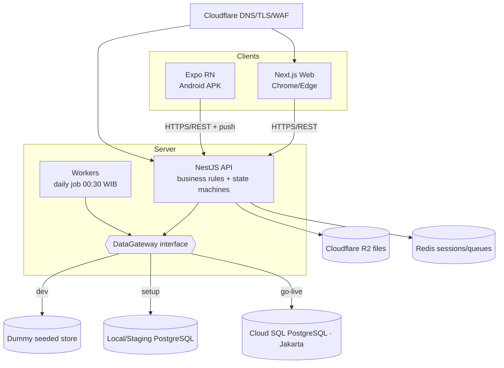

# design.md
> BMI Stooring System — Version 1.0 — 2026-10-30

> Governed by `requirements.md` (this folder) and the authoritative `PRD.md` (SDD Spec v2) at the repo root. `PRD.md` §9 is the final PostgreSQL schema; `DESIGN.md` is the binding visual design system. **Design artifacts in `Design Artifact/` are example mockups of behaviour, not a strict front-end contract** — implement to the requirements and `DESIGN.md`, using each artboard as an illustrative reference only.

## Architecture Overview

A TypeScript monorepo. One NestJS API server owns all business rules, the state machines (PRD §3) and the database; the Next.js web app and the Expo/React Native Android app are clients that reach data **only through the API** (NFR-18, DEC-66). PostgreSQL is the system of record; Cloudflare R2 holds files; Redis backs jobs/queues and sessions. A daily job (00:30 WIB) runs document/PM/alert/schedule recomputation (NFR-12, NFR-14).

The engine is **data-driven**: assignment modules, WO presets, vehicle classes, chassis layouts, tyre statuses, document types and alert rules are master data, so a new module or unit type is added without touching engine, designer, WO-document, scope-lock or permission code (PR-6, REQ-REG-006).

**Stack**: TypeScript monorepo (pnpm/turbo) · NestJS API · Next.js (App Router) web · Expo React Native (Android APK) · PostgreSQL · Redis · Cloudflare R2 (S3-compatible). (DEC-66)
**Deployment**: Google Cloud, Jakarta region — Cloud Run (API, workers, web), Cloud SQL (PostgreSQL), Memorystore (Redis), Secret Manager; Cloudflare R2 for files; Cloudflare DNS/TLS/WAF in front. Android APK distributed signed, outside the Play Store. (DEC-67, NFR-18)

### Phased database strategy (maps to the three implementation phases)

- **Dev phase — dummy database (local MVP).** Run the full stack locally against an **in-memory / seeded dummy data layer** behind a repository interface (a thin `DataGateway` the services depend on, not raw SQL). This lets every feature and flow be exercised end-to-end without a real Postgres, so the team validates behaviour and the state machines early. A local Postgres via Docker Compose is optional here but not required; the dummy gateway is the default. No cloud.
- **Setup phase — real local/staging Postgres.** Swap the `DataGateway` implementation to the real PostgreSQL schema (PRD §9) on a local/staging Postgres (Docker Compose or a staging Cloud SQL). All P0 requirements are completed and wired to the real schema; this is where integration tests, debugging and UAT happen. Minor adjustments to schema/UX are still allowed here.
- **Go-live phase — production database & deploy.** The real schema on Cloud SQL (Jakarta), migrations locked, backups/PITR configured and a restore drill passed (NFR-17), secrets in Secret Manager, R2 + Cloudflare in front. Everything (API, DB, web, APK) must be fully working; no behavioural change beyond fixes.

The **repository/`DataGateway` interface is the seam** that makes this phasing clean: services and business rules are written once against the interface; only the backing implementation changes (dummy → local Postgres → Cloud SQL). This is a hard design rule — business logic must never import a concrete DB driver directly.

## System Diagram



## Data Models

The complete, final schema is **PRD §9** (PostgreSQL syntax, dependency-ordered, every decision applied — do not re-derive). Summary of the aggregate roots and their main tables (PRD §3.1):

| Aggregate | Main tables (PRD §9) | Area |
|---|---|---|
| User & role | `users`, `user_roles`, `role_permissions` | IAM |
| Vehicle | `vehicles`, `vehicle_classes`, `chassis_layouts`, `odometer_logs` | VEH |
| Vehicle document | `document_types`, `vehicle_documents`, `document_renewals`, `document_corrections` | DOC |
| WO preset / module | `wo_presets`, `wo_preset_steps`, `assignment_modules` | REG |
| Work Order | `work_orders`, `work_order_approvals` | WO |
| Step | `work_order_assignments`, `step_time_events`, `step_time_corrections` | ENG |
| WO content | `work_order_parts`, `work_order_services`, `work_order_purchases`, `work_order_purchase_lines`, `wo_attachments` | STK/MEC/PUR |
| Change request | `wo_change_requests` | CR |
| Parts & warehouse | `parts_catalog`, `stock_cards`, `goods_receipts`, `gr_corrections`, `goods_issues`, `goods_issue_items`, `stock_adjustments` | INV |
| Tyres | `tyres`, `tyre_statuses`, `tyre_events`, `tyre_receipts`, `retread_orders`, `tyre_counts` | TYR |
| Placement | `part_positions`, `part_placements`, `part_placement_logs`, `placement_map_snapshots` | PLC |
| Part items | `part_item_types`, `vehicle_part_items`, `early_failure_events` | BSL |
| Alerts & PM | `maintenance_alerts`, `pm_packages`, `pm_tasks`, `vehicle_pm_schedule`, `dvir_logs`, `breakdown_reports` | PM |
| Schedule | `wo_schedule`, `wo_schedule_log`, `schedule_alerts` | SCH |
| Notifications | `notifications`, `notification_deliveries`, `push_devices` | NTF |
| Customers & invoices | `customers`, `invoices`, `invoice_lines`, `invoice_payments`, `invoice_wos` | BIL |
| Files | `stored_files`, `app_settings`, `export_logs` | FUP |
| Audit | `audit_logs` | NFR |

**Invariants enforced at both service and DB layers** (PRD §5): BR-01 (WO-gated changes), BR-02 (scope lock), BR-03 (four-eyes), BR-06 (stock-change channels), BR-10 (append-only/soft-delete), BR-11 (tyre count channels), BR-14 (one System Admin, one role per user), BR-15 (bill once). Optimistic locking via a `version` column (NFR-03).

**State machines** (implement exactly as tabled, PRD §3): SM-WO, SM-STEP, SM-VEH, SM-DOC, SM-TYRE, SM-GR, SM-SA, SM-TR, SM-RD, SM-CR, SM-SCH, SM-INV, SM-TC. A transition not listed is refused.

## API / Interface Design

REST over HTTPS, versioned (`/api/v1`), JSON. Every mutating endpoint: server-side role guard (NFR-04), optimistic-lock check (NFR-03), idempotency key support (NFR-01), and an audit write (NFR-02). The endpoint catalog is derived from the functional groups; it is authored with the **api-designer** skill into an OpenAPI document during the Dev phase and kept in sync (code-documenter skill). Representative resources:

| Area | Resource (example) | REQ |
|---|---|---|
| WO | `POST /work-orders`, `POST /work-orders/{id}/submit|approve|reject|cancel` | REQ-WO |
| Steps | `POST /assignments/{id}/start|pause|resume|submit|verify|return|assign` | REQ-ENG |
| Stock/Purchase | `POST /assignments/{id}/stock-issue`, `/purchase-lines` | REQ-STK, REQ-PUR |
| Placement | `POST /assignments/{id}/placement` (replace/rotate/demount) | REQ-PLC |
| Approvals | `GET /approvals`, `POST /approvals/{id}/decide` | REQ-APR |
| Inventory | `POST /goods-receipts`, `/stock-opname`, `/tyre-count` | REQ-INV, REQ-TYR |
| Invoices | `POST /invoices`, `/invoices/{id}/issue|pay|void` | REQ-BIL |
| Files | `POST /uploads/sign`, worker finalize | REQ-FUP |
| IAM | `POST /auth/login`, `/auth/reset` (email), `/users`, `/roles` | REQ-IAM |

Front-end: Next.js app per the web screen inventory (PRD §7.3) using the `DESIGN.md` tokens/components; Expo RN for the mobile screens. The 153 artboards in `Design Artifact/` (incl. `MobileProfile`, `MechanicMobileHistory`, `SupervisorMobileHistory`, `FCDraftCancel`, and the `SettingsIntegrations` placeholder) are **example references**; build to behaviour and `DESIGN.md`, not pixel-for-pixel.

## File Structure

```
BMI Stooring System/
├─ PRD.md, PRODUCT.md, DESIGN.md         # authoritative references (root)
├─ Design Artifact/                      # 153 example screen mockups (reference only)
├─ .kiro/
│  ├─ specs/bmi-stooring-system/         # requirements.md, design.md, tasks.md, CONTEXT.md
│  └─ skills/                            # installed skills (referenced by tasks)
├─ CLAUDE.md                             # AI constitution (SDD)
├─ apps/
│  ├─ api/                               # NestJS: modules per functional group, state machines, DataGateway
│  ├─ web/                               # Next.js App Router (web screens)
│  └─ mobile/                            # Expo React Native (Android)
├─ packages/
│  ├─ shared/                            # types, DTOs, design tokens (from DESIGN.md), enums
│  ├─ data-gateway/                      # DataGateway interface + dummy / postgres implementations
│  └─ config/                            # numbering, money, time, format helpers (NFR-14..16)
├─ db/                                   # migrations (PRD §9 schema), seed data
├─ docs/                                 # OpenAPI, generated docs (code-documenter)
└─ infra/                                # Docker Compose (dev/setup), Cloud Run/Cloud SQL IaC (go-live)
```

## Security Design

Per NFR-04/05 and the **security-reviewer** + **fullstack-guardian** skills: server-authoritative role checks on every action (the PRD §2.2 matrix, with locked cells), server-side validation, parameterized queries only, secrets in Secret Manager (encrypted at rest), signed expiring links for files, append-only audit, optimistic locking, and the AI assistant on a read-only DB account. Position capture is one-time at step submit for verification only, with the UU-PDP handling of RSK-09 (privacy notice, access logged). A security review is a required gate in the Setup and Go-live phases.

## Skill Integration (referenced by tasks.md)

| Skill | Used for (phases) |
|---|---|
| **spec-driven-development** | Spec authoring, CONTEXT.md discipline, task-closing protocol (all phases). |
| **typescript-pro** | Monorepo types, DTOs, branded IDs, discriminated unions for state machines (all). |
| **api-designer** | REST/OpenAPI design, resource modeling, pagination, error standards (Dev → Setup). |
| **nestjs-expert** | NestJS API implementation: modules per functional group, controllers, services, DTOs, guards, interceptors, dependency injection of the `DataGateway` (all back-end tasks). |
| **nextjs-developer** | Next.js 14+ App Router web app: route handlers, middleware, server components/actions, streaming SSR, `generateMetadata`, loading/error boundaries (all web UI tasks). |
| **fullstack-guardian** | End-to-end feature slices with layered security across API+web (Dev → Setup). |
| **postgres-pro** / **database-optimizer** | Schema from PRD §9, indexes, JSONB, transactions, EXPLAIN tuning (Setup → Go-live). |
| **react-native-expert** | Expo Android app, navigation, offline queue, camera/upload (Setup, R1 step 7). |
| **impeccable** / **frontend-design-direction** | Web/mobile UI quality against DESIGN.md; status-text, 48px targets, a11y (all UI tasks). |
| **test-master** | Unit/integration/E2E suites, coverage, test plans, AC verification (all phases). |
| **security-reviewer** | Security audit gate (Setup, Go-live). |
| **debugging-wizard** | Systematic debugging during the Setup test/debug phase. |
| **code-documenter** | OpenAPI, README, runbooks, user guides (Setup → Go-live). |

## Open Questions

- [ ] **Q-03**: cloud/domain/account ownership — blocks the Go-live deploy and first APK build.
- [ ] **Q-01**: KPI numeric targets (G-2/G-6/G-7) — set ~3 months post-launch; not a build blocker.
- [ ] Repo hosting (GitHub/GitLab) and CI provider for the pipeline tasks — confirm at Dev-phase start.

## Changelog
| Version | Date | Change |
|---|---|---|
| 1.0 | 2026-10-30 | Initial design: monorepo, DataGateway phasing (dummy→local→Cloud SQL), schema/state-machine mapping to PRD, skill integration. |
