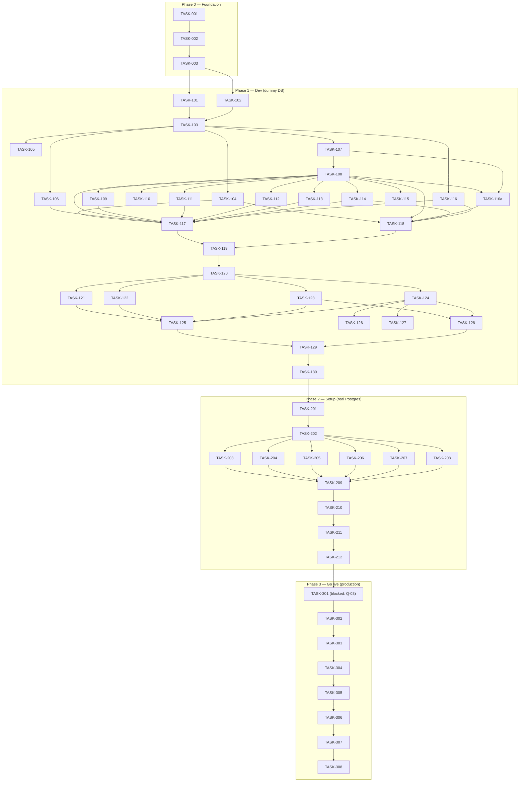

# Implementation Plan: BMI Stooring System
> BMI Stooring System — Version 1.0 — 2026-10-30

## Legend
- [ ] Not started · [~] In progress · [x] Complete · [!] Blocked (reason inline)

## How to use this plan
- Governed by `requirements.md` and `design.md` (this folder) and the authoritative root `PRD.md`.
- **Three implementation phases** (as the product owner defined them):
  - **Phase 1 — Dev (local MVP, dummy database).** Prove the system works end-to-end against the in-memory `DataGateway`; no real DB, no cloud.
  - **Phase 2 — Setup (P0 complete, real schema, test & debug).** All P0 requirements finished against a real local/staging PostgreSQL; integration tests, debugging and UAT; minor adjustments still allowed.
  - **Phase 3 — Go live (deploy-ready).** Production DB (Cloud SQL), backups/restore drill, full stack deployed and perfectly working; fixes only.
- **Skills**: each task names the `.kiro/skills/` skill to load before doing it (e.g. _Skill_: `typescript-pro`). Load the skill, then do the task.
- **Git discipline (every task)**: work on a short-lived branch `type/phaseN-taskNNN-slug`, commit with a Conventional-Commit message referencing the TASK and REQ IDs, then open/merge a PR to `develop` (Phase 1–2) or `main` (Phase 3). The explicit `git` steps are written into each task's _Git_ line. Never commit secrets; `db/seed` dummy data only.
- **Task-closing protocol (spec-driven-development skill)**: before marking `[x]`, run _Verify_; if the implementation diverged from `design.md`, update `design.md` first, then close. Record the session in `CONTEXT.md`.

## Task Dependency Graph

This graph reflects the phase/task ordering implied by the plan above: each phase depends on the one before it, and the intra-phase edges capture the real build order (types → gateway → API scaffold → engines → feature groups → clients → E2E). Grouped by phase with subgraphs.



Execution waves (tasks in the same wave are independent and may run in parallel; a wave starts only after all earlier waves complete):

```json
{
  "waves": [
    { "id": 0, "tasks": ["TASK-001"] },
    { "id": 1, "tasks": ["TASK-002"] },
    { "id": 2, "tasks": ["TASK-003"] },
    { "id": 3, "tasks": ["TASK-101", "TASK-102"] },
    { "id": 4, "tasks": ["TASK-103"] },
    { "id": 5, "tasks": ["TASK-104", "TASK-105", "TASK-106", "TASK-107", "TASK-116"] },
    { "id": 6, "tasks": ["TASK-108"] },
    { "id": 7, "tasks": ["TASK-109", "TASK-110", "TASK-110a", "TASK-111", "TASK-112", "TASK-113", "TASK-114", "TASK-115"] },
    { "id": 8, "tasks": ["TASK-117", "TASK-118"] },
    { "id": 9, "tasks": ["TASK-119"] },
    { "id": 10, "tasks": ["TASK-120"] },
    { "id": 11, "tasks": ["TASK-121", "TASK-122", "TASK-123", "TASK-124"] },
    { "id": 12, "tasks": ["TASK-125", "TASK-126", "TASK-127", "TASK-128"] },
    { "id": 13, "tasks": ["TASK-129", "TASK-130"] },
    { "id": 14, "tasks": ["TASK-201"] },
    { "id": 15, "tasks": ["TASK-202"] },
    { "id": 16, "tasks": ["TASK-203", "TASK-204", "TASK-205", "TASK-206", "TASK-207", "TASK-208"] },
    { "id": 17, "tasks": ["TASK-209"] },
    { "id": 18, "tasks": ["TASK-210"] },
    { "id": 19, "tasks": ["TASK-211"] },
    { "id": 20, "tasks": ["TASK-212"] },
    { "id": 21, "tasks": ["TASK-301"] },
    { "id": 22, "tasks": ["TASK-302"] },
    { "id": 23, "tasks": ["TASK-303"] },
    { "id": 24, "tasks": ["TASK-304"] },
    { "id": 25, "tasks": ["TASK-305"] },
    { "id": 26, "tasks": ["TASK-306"] },
    { "id": 27, "tasks": ["TASK-307"] },
    { "id": 28, "tasks": ["TASK-308"] }
  ]
}
```

---

## Phase 0: Repository & spec foundation (precedes all)
*Goal*: a version-controlled monorepo skeleton and the AI/spec guardrails, so every later task is documented in git.

- [x] **TASK-001** [NFR-SECURITY, DEC-66]: Initialize git and the monorepo skeleton (pnpm + turbo workspaces: `apps/api`, `apps/web`, `apps/mobile`, `packages/shared`, `packages/data-gateway`, `packages/config`, `db`, `docs`, `infra`), with `.gitignore` (node_modules, .env, build output, R2 keys), `.editorconfig`, and root `README.md`.
  - _Skill_: `spec-driven-development`, `typescript-pro`.
  - _Output_: repo tree per design.md "File Structure"; `pnpm install` resolves.
  - _Verify_: `git status` clean after commit; `pnpm -w run build` runs (even if no-op); `.env` is git-ignored.
  - _Git_: `git init` → `git checkout -b chore/phase0-task001-scaffold` → `git add` named files → `git commit -m "chore(repo): scaffold monorepo [TASK-001]"` → create `develop` and `main` branches → push with `-u`.
- [x] **TASK-002** [all]: Generate `CLAUDE.md` (AI constitution) and `CONTEXT.md` (session journal) from the SDD templates; add tooling config (tsconfig base, eslint, prettier, commitlint + Conventional Commits, husky pre-commit running lint+typecheck).
  - _Skill_: `spec-driven-development`, `typescript-pro`.
  - _Output_: `CLAUDE.md`, `CONTEXT.md`, lint/format/commit hooks.
  - _Verify_: a deliberate bad commit message is rejected by commitlint; `pnpm lint` passes on the skeleton.
  - _Git_: branch `chore/phase0-task002-tooling` → commit `chore(tooling): CLAUDE.md, CONTEXT.md, lint/commit hooks [TASK-002]` → PR to `develop`.
- [x] **TASK-003** [NFR-FORMAT, NFR-TIME, NFR-NUMBERING, NFR-MONEY]: Build `packages/config` cross-cutting helpers: Indonesian number/date/time formatting (NFR-09), UTC↔WIB and WIB-day helpers (NFR-14), never-reused running-number generator with configurable formats (NFR-15), money rounding half-up (NFR-16).
  - _Skill_: `typescript-pro`, `test-master`.
  - _Output_: `packages/config` with unit tests.
  - _Verify_: unit tests assert `48.210 km`, `Rp 1.240.000`, `2,4 mm`, WIB-day boundaries, and AC-BIL-005 rounding.
  - _Git_: `feat(config): format/time/number/money helpers [TASK-003]`.

---

## Phase 1 — Dev (local MVP, dummy database)
*Goal*: Every functional group works end-to-end locally against the in-memory `DataGateway`, so the team can click through each flow and confirm the state machines behave — with no real database and no cloud. Exit criterion: each FG's happy-path + key `AC-*` run green against dummy data, and the web/mobile shells render the core flows.

- [x] **TASK-101** [FG-1..FG-18, PR-6]: Define `packages/shared` domain types, DTOs, branded IDs and the enums/discriminated unions for every state machine (SM-WO, SM-STEP, SM-VEH, SM-DOC, SM-TYRE, SM-GR/SA/TR/RD/CR/SCH/INV/TC) from PRD §3.
  - _Skill_: `typescript-pro`.
  - _Output_: shared types; a `transition()` helper per machine that refuses unlisted transitions.
  - _Verify_: unit tests reject every transition not in the PRD §3 tables.
  - _Git_: `feat(shared): domain types + state-machine guards [TASK-101]`.
- [x] **TASK-102** [NFR-INTEGRITY, NFR-CONCURRENCY]: Define the `DataGateway` interface in `packages/data-gateway` (repository per aggregate, transactional `unitOfWork`, optimistic `version`) and an **in-memory dummy implementation** seeded with the PRD's example data (WO-0142, B 1234 ABC, tyres TY-01xx, etc.).
  - _Skill_: `typescript-pro`, `fullstack-guardian`.
  - _Output_: `DataGateway` + `DummyDataGateway` + seed.
  - _Verify_: a unit-of-work test proves all-or-nothing writes; a concurrent-save test rejects the stale `version`.
  - _Git_: `feat(data-gateway): interface + dummy impl + seed [TASK-102]`.
- [x] **TASK-103** [NFR-SECURITY, DEC-66]: Scaffold the NestJS API with module-per-functional-group, dependency-injected `DataGateway` (bound to dummy in dev), a global role-guard reading the PRD §2.2 matrix, request validation, idempotency middleware and an audit interceptor (writes to the dummy `audit_logs`).
  - _Skill_: `nestjs-expert`, `api-designer`, `fullstack-guardian`, `typescript-pro`.
  - _Output_: running API; `/health`; guard+audit cross-cutting.
  - _Verify_: an unauthorized role is refused with a server-side 403 in a test; every mutating call writes an audit record.
  - _Git_: `feat(api): Nest scaffold, role guard, audit, idempotency [TASK-103]`.
- [x] **TASK-104** [FG-13, REQ-IAM, NFR-AUTH, §7.11 DQ-02]: IAM module — login, first-sign-in change, lockout, sessions (web 30 min idle / mobile 30 d), email password reset (DQ-02), one-role-per-user and one-System-Admin invariants (BR-14), permission-matrix read, Planner-approval switch, audit log.
  - _Skill_: `nestjs-expert`, `fullstack-guardian`, `security-reviewer`, `typescript-pro`.
  - _Output_: auth + accounts endpoints against dummy data.
  - _Verify_: AC-IAM-001..007 pass against dummy; NFR-AUTH five rules tested.
  - _Git_: `feat(iam): auth, accounts, permissions, audit [TASK-104]`.
- [x] **TASK-105** [FG-14, REQ-SETUP, ASM-64]: Setup mode & Go-live switch — only System Admin + Access Manager sign in, no approvals, bulk import (Setup-mode only), opening balance, one-way Go-live flag.
  - _Skill_: `nestjs-expert`, `fullstack-guardian`, `typescript-pro`.
  - _Output_: Setup-mode gating + Go-live endpoint against dummy.
  - _Verify_: AC-IAM-006, AC-INV-006; a non-admin login is refused while in Setup mode.
  - _Git_: `feat(setup): setup mode, bulk import, go-live switch [TASK-105]`.
- [x] **TASK-106** [FG-7, REQ-VEH, REQ-DOC, SM-VEH, SM-DOC, DEC-92]: Vehicles, classes, chassis layouts, documents (first entry/correction/renewal, status machine) and odometer (manual/driver, void, jump warning). The derived vehicle status now includes **OFF** — an escalation of Repair when a scheduled WO overruns its planned day while the vehicle is already in Repair; `vehicle_status_t` gains `'OFF'`; precedence is Inactive > OFF > Blocked > Repair > Active; OFF does not block WO creation or amendment (REQ-WO-013 applies only to Inactive).
  - _Skill_: `nestjs-expert`, `fullstack-guardian`, `typescript-pro`.
  - _Output_: VEH/DOC endpoints + derived vehicle status (incl. OFF).
  - _Verify_: AC-VEH-001..004, AC-DOC-001..006; SM-VEH precedence (Inactive > OFF > Blocked > Repair > Active) and SM-DOC transitions; OFF holds until the overrunning WO is Completed or Cancelled and does not block WO creation.
  - _Git_: `feat(vehicles): vehicles, documents, odometer [TASK-106]`.
- [x] **TASK-107** [FG-3, REQ-REG, PR-6, DEC-85, DEC-88]: Module registry (6 modules), step composer data model, WO presets (versioned), PM packages; live composer checks (REQ-REG-004); no module hard-coded.
  - _Skill_: `nestjs-expert`, `typescript-pro`, `fullstack-guardian`.
  - _Output_: registry + preset + composer-check services.
  - _Verify_: AC-REG-001..005; adding a 7th dummy module appears in the designer with no engine edit.
  - _Git_: `feat(registry): modules, presets, composer checks [TASK-107]`.
- [x] **TASK-108** [FG-1, FG-2, REQ-WO, REQ-ENG, REQ-MBL-001, SM-WO, SM-STEP, DEC-87]: WO lifecycle + assignment engine — create/submit/approve/reject/cancel/amend; step open-on-submit, claim/assign/reassign/release, Start/Pause/Resume time events, verify/return, completion gate. Four-eyes (BR-03), scope lock (BR-02). Draft-only discipline: Field Coordinator / Mechanic / Driver create Draft WOs only (never activate); Planner activates, Supervisor approves. A `Driver_Breakdown` draft WO is auto-created pre-seeded with exactly one Mobilisasi step (REQ-MBL-001) at the driver's captured location. Field-finding note (`work_orders.finding_note`, REQ-WO-016): drafts from a Field Coordinator or Mechanic require a non-empty `finding_note` at send-for-review (server refuses when empty); driver-sourced drafts auto-copy `finding_note` from the breakdown/inspection notes; and `finding_note` is preserved when the Planner edits `description`. `work_orders.priority` (Low/Normal/High/Urgent) is the WO's urgency label that drives list/inbox ordering and the colour-coded urgency pill (REQ-WO-015).
  - _Skill_: `nestjs-expert`, `fullstack-guardian`, `typescript-pro`.
  - _Output_: WO + engine endpoints against dummy, incl. breakdown→auto-draft-with-one-Mobilisasi-step.
  - _Verify_: AC-WO-001..006, AC-ENG-001..009; every SM-WO/SM-STEP transition; a `Driver_Breakdown` draft carries exactly one Mobilisasi step at the captured location; an FC/Mechanic draft with an empty `finding_note` is refused at send-for-review; a `Driver_Breakdown` draft has `finding_note` copied from the breakdown description; Urgent/High WOs sort first in lists and inbox.
  - _Git_: `feat(wo): lifecycle + assignment engine + timing [TASK-108]`.
- [x] **TASK-109** [FG-4, REQ-STK, REQ-PUR, BR-01, BR-06, DEC-60]: Stock step (atomic goods issue + stock card + moving-average cost; shortfall; verified reversal) and Part Purchase step (typed qty/price, totals, receipt photo, no stock change).
  - _Skill_: `nestjs-expert`, `fullstack-guardian`, `typescript-pro`.
  - _Output_: STK/PUR submit handlers against dummy (transaction simulated in unit-of-work).
  - _Verify_: AC-STK-001..006, AC-PUR-001..006.
  - _Git_: `feat(stock): stock step + part purchase [TASK-109]`.
- [x] **TASK-110** [FG-5, REQ-MEC, REQ-CHK, DEC-88, DEC-89, DEC-90]: Mechanic Action (internal/external, labor, photos), Part Check (Good/Repair/Replace → follow-up Draft WO on verify). Mechanic Action no longer captures device position and no longer charges stooring (REQ-MEC-007..009 retired, DEC-90); stooring moves to the Mobilisasi module (TASK-110a).
  - _Skill_: `nestjs-expert`, `fullstack-guardian`, `typescript-pro`.
  - _Output_: MEC/CHK handlers against dummy (no location capture, no stooring calc).
  - _Verify_: AC-MEC-001..005 (AC-MEC-004/005 now assert NO location captured and Rp 0 stooring on Mechanic Action), AC-CHK-001..004.
  - _Git_: `feat(mechanic): mechanic action + part check [TASK-110]`.
- [x] **TASK-110a** [FG-5a, REQ-MBL, SM-STEP, PR-6, RSK-09, DEC-90]: Mobilisasi module — implement the mobilisation assignment module as data-driven master data (registry row, no engine change): executor Mechanic; Start opens a route/map to the driver's captured destination; auto-submit on arrival with a manual "Finish stooring" fallback; record the mechanic's location trail only while In_Progress (`mobilisation_location_trail`); compute the stooring fee once per WO/region/day from the stooring-rates master; Planner/System-Admin-only access to the trail with every access logged (RSK-09 / UU-PDP).
  - _Skill_: `nestjs-expert`, `fullstack-guardian`, `typescript-pro`.
  - _Output_: Mobilisasi module handlers (start/finish/route/trail) + stooring calc against the dummy gateway.
  - _Verify_: AC-MBL-001..004; trail recorded only while In_Progress and stops at submit; stooring charged once per WO/region/day.
  - _Git_: `feat(mobilisasi): mobilisation module + stooring + location trail [TASK-110a]`.
- [x] **TASK-111** [FG-6, REQ-PLC, BR-11, SM-TYRE, DEC-68, DEC-73]: Part Replacement + data-generated chassis map (replace/rotate/demount within scope lock), placement history, trailer/spare layouts, placement snapshot.
  - _Skill_: `nestjs-expert`, `fullstack-guardian`, `typescript-pro`.
  - _Output_: PLC endpoints + map model.
  - _Verify_: AC-PLC-001..010 (incl. generated 1–6 axle layouts).
  - _Git_: `feat(placement): part replacement + chassis map [TASK-111]`.
- [x] **TASK-112** [FG-8, REQ-BSL, REQ-INV, REQ-TYR, BR-06, BR-11]: Parts baseline, parts catalog, Goods Receipts & corrections, stock card, stock opname (approval), and tyres end-to-end (receive/issue/mount/rotate/demount/retread/worn-out/scrap/count) with codes/events.
  - _Skill_: `nestjs-expert`, `fullstack-guardian`, `postgres-pro`, `typescript-pro`.
  - _Output_: BSL/INV/TYR endpoints against dummy.
  - _Verify_: AC-BSL-001..005, AC-INV-001..005, AC-TYR-001..007.
  - _Git_: `feat(inventory): baseline, parts, tyres, opname [TASK-112]`.
- [x] **TASK-113** [FG-9, FG-10, REQ-CR, REQ-APR, SM-CR, DQ-07]: Change requests & amendments (executor raises, WO creator decides) and approvals inbox (creation/amendment/completion/warehouse counts) with part-age/early-failure on review.
  - _Skill_: `nestjs-expert`, `fullstack-guardian`, `typescript-pro`.
  - _Output_: CR/APR endpoints.
  - _Verify_: AC-CR-001..005, AC-APR-001..005.
  - _Git_: `feat(approvals): change requests + approvals inbox [TASK-113]`.
- [x] **TASK-114** [FG-12, REQ-PM, REQ-SCH, REQ-SCH-003, REQ-NTF, REQ-DSH, REQ-MBL-002, SM-SCH, DEC-86, DEC-92]: PM/alert engine (alert rules → draft WO), maintenance schedule (plan-only), in-app notifications, role dashboards (data), simulated daily job. The idempotent daily job (00:30 WIB) now **auto-rolls a missed schedule card forward one day each day with no limit** until the WO is Completed or Cancelled (never blocking or cancelling it), flags `wo_schedule.is_rolled_over`, **recalculates the derived vehicle status (including OFF)**, and increments the overrunning WO's `work_orders.off_days` once per WIB day (guarded for idempotency by `off_last_counted_date`). Breakdown drafting: a `Driver_Breakdown` report auto-creates a Draft WO pre-seeded with exactly one Mobilisasi step at the driver's captured breakdown location (REQ-MBL-002 feeds the destination) and copies the driver's breakdown description into `work_orders.finding_note` (REQ-WO-016).
  - _Skill_: `nestjs-expert`, `fullstack-guardian`, `typescript-pro`.
  - _Output_: PM/SCH/NTF/DSH endpoints + a runnable daily-job function (roll-forward + `is_rolled_over` + OFF recalc + `off_days`/`off_last_counted_date`) + breakdown→auto-draft-with-one-Mobilisasi-step.
  - _Verify_: AC-PM-001..003, AC-SCH-001..004; daily job idempotent on re-run; a missed card rolls forward one day and sets `is_rolled_over`; the OFF vehicle status is recalculated; `off_days` increments exactly once per WIB day and re-running the job the same day never double-counts; a breakdown report yields a single-Mobilisasi-step Draft WO at the captured location with `finding_note` copied from the breakdown description.
  - _Git_: `feat(pm): alerts, schedule, notifications, dashboards [TASK-114]`.
- [x] **TASK-115** [FG-11, REQ-WOD, REQ-BIL, REQ-BIL-003, SM-INV, BR-15, DEC-92]: WO document renderer (approval block, execution-time table, B/W placement snapshot) and invoices (daily per vehicle, markup/PPN, numbering, Draft→Issued→Paid→Void). Invoicing now emits an **`Off_Unit`** line = `work_orders.off_days` × the global `app_settings.off_unit_daily_rate`, billed to the vehicle's customer at cost (no markup) and included in the subtotal and PPN. This task also owns the **OFF-unit daily rate** master (`app_settings.off_unit_daily_rate`, System Admin, Settings) that the daily job and this line consume.
  - _Skill_: `nestjs-expert`, `fullstack-guardian`, `typescript-pro`, `code-documenter`.
  - _Output_: WO-doc + invoice services; PDF generation stub; OFF-unit daily rate Settings master + endpoint.
  - _Verify_: AC-WOD-008, AC-BIL-001..005 (arithmetic exact per NFR-MONEY); the `Off_Unit` line equals `off_days` × `off_unit_daily_rate` at cost (no markup) and is included in subtotal and PPN.
  - _Git_: `feat(billing): WO document + invoices [TASK-115]`.
- [x] **TASK-116** [FG-16, REQ-FUP, NFR-FILES]: File upload pipeline against a **local/dummy object store** (device-side compress stub, signed-link issue, server re-check/compress worker, three states, append-only).
  - _Skill_: `nestjs-expert`, `fullstack-guardian`, `typescript-pro`.
  - _Output_: FUP endpoints + worker against a local store.
  - _Verify_: AC-FUP-001..006 (an MP4 renamed .jpg is rejected; a 4 MB photo → <1 MB, no EXIF GPS).
  - _Git_: `feat(files): upload/compress pipeline (local) [TASK-116]`.
- [x] **TASK-117** [FG-1..FG-14, REQ-WO-015, REQ-SCH-003, DESIGN.md, NFR-A11Y, DEC-92]: Web app shell (Next.js) + core desktop flows (sign-in, dashboards, WO list/detail/create composer, step screens, approvals, inventory, vehicles) wired to the API, using `DESIGN.md` tokens; the Requests list / Create WO composer shows the draft's `finding_note` to the Planner as read-only context, preserved even when editing `description` (REQ-WO-016). WO lists, the schedule and Create WO show the colour-coded urgency pill (always carrying its text label, WCAG) and the rolled-over/late flag on schedule cards. Design artifacts used as **examples only**.
  - _Skill_: `nextjs-developer`, `impeccable`, `frontend-design-direction`, `typescript-pro`.
  - _Output_: clickable web flows against dummy-backed API.
  - _Verify_: core flows navigable; status carries text; a11y scan clean on built screens; the Requests list / Create WO screen displays the draft `finding_note` read-only and keeps it when the Planner edits `description`; the urgency pill shows its text label and schedule cards show the rolled-over/late flag.
  - _Git_: `feat(web): app shell + core WO/inventory/approval flows [TASK-117]`.
- [x] **TASK-118** [FG-15, REQ-MOB, REQ-MOB-010, REQ-MBL-002, §7.11, NFR-A11Y, DEC-92]: Mobile app shell (Expo RN) + R1 field flows (MobileLogin role menu, Driver inspection/odometer/breakdown/history, Field Coordinator requests/purchase, System Admin field menu, shared MobileProfile with notification settings DQ-01) against the API. Driver breakdown flow: the app captures the driver's location once on breakdown report plus the mandatory field-finding note that becomes the draft's `finding_note` (REQ-WO-016, REQ-MOB-004), and triggers the auto-drafted WO (pre-seeded with one Mobilisasi step at that location). The Field Coordinator mobile draft flow requires a typed finding note before send-for-review. The mechanic's continuous GPS trail belongs only to an In_Progress Mobilisasi step (R2 mechanic mobile), not the driver app. The **Mechanic mobile task list** (R2 mechanic menu) shows only WOs scheduled for today (WIB) and assigned to that mechanic, ordered by urgency descending with rolled-over/late first, each carrying its urgency pill (text label present, WCAG) and rolled-over flag (REQ-MOB-010).
  - _Skill_: `react-native-expert`, `impeccable`, `typescript-pro`.
  - _Output_: Android app running in Expo against dummy-backed API.
  - _Verify_: AC-MOB-001..004 happy paths; 48px targets; menu follows role; breakdown report captures location once plus the mandatory note (→ `finding_note`) and triggers the auto-drafted Mobilisasi WO; an FC mobile draft cannot be sent for review without a typed finding note; the Mechanic mobile task list (R2) lists only today-scheduled WOs assigned to that mechanic, ordered by urgency descending with rolled-over/late first, each with its urgency pill and rolled-over flag.
  - _Git_: `feat(mobile): Expo shell + R1 field flows [TASK-118]`.
- [x] **TASK-119** [all P0 FGs]: Dev-phase E2E smoke suite — one scripted end-to-end per functional group against the dummy gateway (create→approve→execute→verify→complete→invoice).
  - _Skill_: `test-master`.
  - _Output_: Playwright/API E2E smoke suite; CI job on `develop`.
  - _Verify_: all smoke E2E green; coverage report produced.
  - _Git_: `test(e2e): dev-phase smoke suite [TASK-119]` → tag `v0.1.0-dev-mvp` on `develop`.

### Phase 1 — PRD coverage closure (gap tasks; do not alter completed tasks)
*Goal*: close every gap the Phase-1 audit found between the shipped dummy-gateway MVP and the full PRD intent — the API pockets (audit/export, part-item master, Settings masters) and the web/mobile screen inventory (PRD §7.3) that TASK-117/118 scoped to "shell + core flows" only. Each task stays on the dummy gateway (Phase-1 discipline), keeps every **completed** task (`[x]`) untouched, and is traced in `requirements.md` "PRD Coverage & Traceability".

**Run order (TASK-120 first, then web-first).** **TASK-120 runs first** and reconciles **every earlier Phase-1 task (TASK-101..119)** to the PRD — but **only where an implementation diverges from the PRD intent**; anything already faithful is left untouched (see TASK-120). Only after that clean base is in place do the other gap tasks run, in this order: **Fase A — API prerequisites** (TASK-121 audit/export, TASK-122 part-item master, TASK-123 Settings masters) → **Fase B — web app to full PRD §7.3 coverage** (TASK-124 shared components → TASK-125 composer/step screens → TASK-126 dashboards/approvals → TASK-127 inventory/vehicles/documents/schedule → TASK-128 settings/invoices/setup/access-manager/shell) → **Fase C — mobile R1 completion (TASK-129) + behavioural FLW-* suite (TASK-130), last**. The product owner's priority is the **web app**: after **each** web task (TASK-124…128) the app must stay runnable end-to-end against the dummy-backed API — `pnpm --filter @bmi/api start` on :3000 + `pnpm --filter @bmi/web dev` on :3100 — so the owner can click through the new screens immediately; "done" for a web task includes a live local smoke of its screens. A "how to run locally" note lives in `apps/web/README.md` (added/updated by TASK-120).

**No anti-overwrite after TASK-120 — follow the PRD freely.** Because **TASK-120 has already reconciled every prior Phase-1 task (TASK-101..119) to the PRD wherever it had diverged**, the later gap tasks are **not** bound by an "extend, never rewrite" rule: they build the full PRD §7.3 screens on TASK-120's clean base, free to restructure whatever best serves the PRD. The only standing constraints are the project-wide ones: stay on the Phase-1 dummy gateway (never import a concrete DB driver), reuse a component/endpoint a sibling task already built instead of duplicating it, keep the full workspace build/typecheck/lint/test green before each `[x]`, and follow the divergence protocol for any §9 data-model or §3 state-machine change (update `design.md`/`requirements.md` first). The API gap tasks (TASK-121/122/123) **add** endpoints/services to existing modules and the empty `SettingsModule`/`ReportsModule` stubs; combined with TASK-120's API reconciliation they leave every prior API test green.

**MVP completeness guarantee.** Every one of the PRD's **251 P0 requirements** and **130 AC** is mapped in `requirements.md` "PRD Coverage & Traceability"; nothing P0 is dropped. Items the PRD itself marks **P1/P2** (AI, Reports, iOS, Mechanic/Supervisor mobile menus, Protrack, WhatsApp/email, amendment-history attachment, optional step skip, photo labels, GPS trail) are **listed as deferred with their release**, not silently removed — out of the Phase-1 MVP gate by PRD §10, built in Release 2. If any Phase-1 task is found narrower than its PRD REQ/AC/§7.3 scope, it is widened (or a conflict raised) **before** it is marked `[x]`.
- [x] **TASK-120** [FG-1..FG-18, PRD §1..§9 (whole-PRD audit), §7.3/§7.4/§7.9, §6, NFR-A11Y; FULL AUTHORITY over EVERY earlier Phase-1 task (TASK-101..119), used ONLY where an implementation diverges from the PRD; RUNS FIRST]: **Reconcile the entire shipped Phase-1 implementation to the original PRD intent — before any other gap task.** This is the **first** gap task. It has **full authority to change, refactor, replace or delete** anything produced by **any** earlier Phase-1 task — not only TASK-117 (web) and TASK-118 (mobile), but also the shared types (TASK-101), the dummy `DataGateway` + seed (TASK-102), the API scaffold/guard/audit/idempotency (TASK-103), IAM (TASK-104), Setup/Go-live (TASK-105), Vehicles/Documents/Odometer (TASK-106), the registry/presets (TASK-107), the WO lifecycle + assignment engine (TASK-108), Stock/Part-Purchase (TASK-109), Mechanic/Part-Check (TASK-110), Mobilisasi (TASK-110a), Part-Replacement/chassis (TASK-111), inventory/tyres (TASK-112), change-requests/approvals (TASK-113), PM/schedule/notifications/dashboards/daily-job (TASK-114), WO-document/invoices (TASK-115), files (TASK-116) and the E2E smoke (TASK-119). **This authority is strictly conditional: it is exercised ONLY on implementation that has drifted from the original PRD intent** — a REQ/AC behaviour not matched, a §2.2 permission cell wrong, a §3 state-machine transition off, a §9 field/shape missing or misused, a §7.3/§7.4/§7.9 screen/layout/action-map divergence, an NFR/BR/DEC not honoured, or a scope a completed task narrowed below its PRD REQ/AC. **Anything already faithful to the PRD is left untouched.** The task runs a **whole-PRD conformance audit** (every REQ, AC, BR, NFR, SM, DEC, §9 table and §7.3 artboard, against `requirements.md` "PRD Coverage & Traceability") and, for each confirmed divergence only, fixes it at its source — web, mobile, API endpoint/guard/DTO/behaviour, shared types, gateway seed, or a module's rule — never importing a concrete DB driver (Phase-1 dummy-gateway discipline holds). It re-runs the full workspace build/typecheck/lint/test so nothing regresses, and leaves a clean, PRD-faithful base on which TASK-121..130 build with no anti-overwrite constraint. **It does not change the completion status of earlier tasks** (TASK-101..119 stay `[x]`/`[ ]` as they are) — it corrects their output, not their ledger. Divergence protocol still applies: a **data-model (§9) or state-machine (§3)** change requires updating `design.md`/`requirements.md` first; and because the reconciliation targets real PRD conformance, any change it makes is logged in the reconciliation report with the exact PRD item (REQ/AC/BR/NFR/SM/DEC/§9/§7.3) it brings into line.
  - _Skill_: `nextjs-developer`, `react-native-expert`, `impeccable`, `frontend-design-direction`, `nestjs-expert`, `fullstack-guardian`, `code-reviewer`, `typescript-pro`.
  - _Artboards_ (PRD §7.3, authority to correct any): **all P0 web artboards** and **all R1 mobile artboards** (the full §7.3 inventory catalogued in design.md "Screen Inventory & Coverage"); each delivered screen must match its artboard's layout/flow (reference, not pixel-for-pixel) and satisfy its REQ/AC.
  - _Output_: a whole-Phase-1 PRD-conformance audit + a reconciled, PRD-faithful base (web, mobile, API, shared types, gateway seed, module rules) where — and only where — an earlier task diverged; a **reconciliation report** listing every change made, each mapped to the exact PRD item (REQ/AC/BR/NFR/SM/DEC/§9/§7.3) it brings into line, and explicitly noting the parts of each earlier task left untouched because they already conform.
  - _Verify_: the whole-PRD conformance audit shows **zero unresolved divergences** across TASK-101..119 (every REQ/AC/BR/NFR/SM/DEC/§9/§7.3 item either already conformant or fixed here); a screen-by-screen pass against PRD §7.3/§7.4/§7.9; the web app runs locally (`@bmi/api` :3000 + `@bmi/web` :3100) with every route reachable and correct; **every** prior `AC-*` still passes and no earlier task's conformant behaviour was changed; `pnpm -w run build`/`typecheck`/`lint`/`test` green; the reconciliation report maps each change to its PRD item.
  - _Git_: `refactor(phase1): reconcile all prior tasks to PRD intent where divergent [TASK-120]`.
- [x] **TASK-120a** [FG-1..FG-15, PRD §7.3, §7.4, §7.9, §7.1/§7.2, NFR-A11Y; visual/layout audit of TASK-117/118 output; part of the TASK-120 reconciliation]: **Audit and align the web + mobile screens that already exist against their PRD §7.3 artboards, §7.4 layouts and §7.9 action map.** TASK-120 reconciled behaviour but did not run the visual/layout audit; this task closes that. **Scope is the already-built screens only** — the web routes shipped by TASK-117 (`login`, app shell, `dashboard`, `work-orders` list/detail/composer/step, `approvals`, `inventory`, `requests`, `schedule`, `vehicles`) and the mobile screens shipped by TASK-118 (MobileLogin, Driver inspection/odometer/breakdown/history, Field Coordinator requests/purchase, System Admin field menu, Mechanic today, Profile). Screens that do not yet exist (Settings, Invoices/Customers, Setup/Go-live, Access Manager, full step screens, ChassisMap, Documents, …) are **out of scope** — they are built by TASK-124..129. **Method (artboards are `.dc.html` code, not images):** for each existing screen read its artboard in `Design Artifact/<name>-html/<Token>.dc.html` (inline styles + `<helmet><style>` carry the exact region layout, DESIGN.md brand tokens, control set), its §7.4 "Key screen layouts" row and its §7.9 action-map rows, then classify CONFORMANT (leave untouched) or DIVERGENT and fix only real divergences — missing/mislaid regions, wrong master-detail/tabs/bottom-bar structure, absent controls the action-map names, colour-only status (must carry its text label, NFR-A11Y), brand tokens not applied (brand.primary #AD2713, petrol #1F4E5F, ink #14262E, mist #E6EFF1, selection #F2D98A, 2px red focus ring), the logo not on its white tile, and the app-shell header bell / collapsible rail (DEC-82) where §7.2 requires them. Artboards are an illustrative reference (PRD §7.1/§7.7), not pixel-for-pixel: match region structure + control set + tokens + status-as-text, build to the REQ + DESIGN.md. Phase-1 dummy-gateway discipline holds (web stays RSC + Server Actions + `src/lib/api.ts`, reuse `@bmi/shared`); do not change the API/shared/config/gateway, do not build new screens.
  - _Skill_: `nextjs-developer`, `react-native-expert`, `impeccable`, `frontend-design-direction`, `code-reviewer`, `typescript-pro`.
  - _Artboards_ (PRD §7.3, the already-built screens): WebLogin, AppShellCollapsed + the Planner/Mechanic/Warehouse/Supervisor-GM/SystemAdmin/FieldCoordinator/Accounting dashboards, WOList, WorkOrder, CreateWO, StepVerify/StepLocked/StepReturned, Approvals, Inventory, FCRequests, MaintenanceSchedule, Vehicles/VehicleOverview; MobileLogin, DashboardDriver, DriverInspection/Odometer/Breakdown/History, FCMobileRequests/FCMobilePurchase, SAMobileHome, MechanicMobileHome(today), MobileProfile.
  - _Output_: the aligned existing web + mobile screens + a "## Visual/layout audit vs §7.3 artboards" section appended to `docs/TASK-120-reconciliation.md` listing, per screen, CONFORMANT or the divergences fixed (each mapped to its artboard + §7.4/§7.9 item) and the screens still owned by TASK-124..129.
  - _Verify_: each existing screen's region layout + control set + brand tokens + status-as-text match its artboard/§7.4/§7.9 (or the divergence is documented as owned by a later task); `pnpm -w run build`/`typecheck`/`lint`/`test` green; the web app runs locally (`@bmi/api` :3000 + `@bmi/web` :3100) and every existing route renders.
  - _Git_: `fix(web+mobile): align existing screens to §7.3 artboards [TASK-120a]`.
- [ ] **TASK-121** [FG-13, FG-8, REQ-IAM-007, REQ-INV-008, DEC-74, §7.9 C-26]: Audit-log read + exports. Add a read/query surface over the append-only `audit_logs` (`GET /audit-logs` with user/entity/date filters; GM/System-Admin/Access-Manager view per §2.2), the **audit-log export** and the **stock-card export** (xlsx/csv, writing an `export_logs` row) — the only P0 exports (DEC-74). Audit is already written by the global interceptor (TASK-103); this task makes it readable and exportable. Powers AuditLog + StockCardExport (§7.3).
  - _Skill_: `nestjs-expert`, `typescript-pro`.
  - _Output_: audit read/query + audit/stock-card export endpoints against the dummy store; `export_logs` write.
  - _Verify_: REQ-IAM-007 (every change is queryable with user/role/time), DEC-74 export produces the current filtered table and logs an `export_logs` row; a role without the audit view is refused 403.
  - _Git_: `feat(audit): audit-log read + audit/stock-card export [TASK-121]`.
- [ ] **TASK-122** [FG-8, REQ-BSL-003, REQ-BSL-006, REQ-BSL-007, REQ-BSL-009, DEC-62]: Part-item master + auto-reset. Implement the `part_item_types` master (normal life km/days + early-failure tolerance, maintained by Planner/System Admin, REQ-BSL-007) and `vehicle_part_items` (last replaced, next due, REQ-BSL-003); on WO completion **reset the linked part items** (REQ-BSL-006, DEC-62) and write `early_failure_events`; replace the Phase-1 manual `approvals.setPartAgeFacts` with a read from this master (the `part-age.ts` rule is unchanged).
  - _Skill_: `nestjs-expert`, `fullstack-guardian`, `typescript-pro`.
  - _Output_: part-item master + reset-on-complete + early-failure events against the dummy gateway; approvals read real part-age facts.
  - _Verify_: AC-BSL-004/005 end-to-end (a completed WO resets the part item and the next review shows the recomputed life-used %/early-failure); a purchased line resets its SKU's part item (AC-PUR-004).
  - _Git_: `feat(bsl): part-item master + reset-on-complete + early-failure [TASK-122]`.
- [ ] **TASK-123** [FG-17, REQ-TYR-003, REQ-PM-006, REQ-BIL-004, REQ-BIL-007, REQ-BSL-007, §2.2 "Other master data"]: Complete the Settings masters. Fill the empty `SettingsModule` into a real controller that exposes every remaining P0 master not yet reachable: **tyre statuses** (REQ-TYR-003), **alert thresholds** (REQ-PM-006: dead-stock 180 d, odometer-jump 1.500 km/day, file-storage budget), the **invoices & tax editor** (REQ-BIL-004/007 — expose the existing `AppSettingsService.setTaxPct`/`setPartMarkupPct`), and the part-item-types editor (TASK-122), consolidating with the masters already shipped (alert rules, service catalog, classes/layouts, document types, presets/PM packages, stooring rates, OFF-unit rate, vendors). All `settings.manage`/`masterdata.manage`.
  - _Skill_: `nestjs-expert`, `fullstack-guardian`, `typescript-pro`.
  - _Output_: Settings masters controller/endpoints against the dummy gateway (powers the §7.3 Settings screens).
  - _Verify_: each named master is readable + editable with an audit record; a non-System-Admin is refused; defaults match PRD (tax 11%, markup 50%, warning days 30, dead stock 180 d).
  - _Git_: `feat(settings): tyre statuses, thresholds, invoices & tax, part-item types [TASK-123]`.
- [ ] **TASK-124** [FG-16, FG-6, FG-10, PRD §7.5, NFR-A11Y, REQ-FUP-016, REQ-PLC-008]: Web shared-component library (PRD §7.5). Build the core shared components the screen inventory depends on, to `DESIGN.md` tokens + WCAG 2.2 AA + reduced-motion: **ChassisMap** (data-generated from the layout, editable/read-only/preview modes, REQ-PLC-008/010), **PhotoViewer** (REQ-FUP-016), **FileDrop** three-state (REQ-FUP-007), **StepTracker/StepBanner**, **ApprovalBlock** (+ the authored stamp motion), **AlertList**, **PartAgeCard** (REQ-APR-011), **ColumnChooser** (NAV-7), and extend StatusPill. Design artifacts are examples only.
  - _Skill_: `nextjs-developer`, `impeccable`, `frontend-design-direction`, `typescript-pro`.
  - _Output_: reusable web components with unit/interaction tests; used by TASK-125…127.
  - _Artboards_ (PRD §7.3, reference only): `Component photo and file viewer (dialog)` (PhotoViewer), `Component file upload, seamless (FileDrop)` (FileUploadStates), `Step Part Replacement map` + `Vehicle classes and chassis layouts` (ChassisMap), `WO detail verification and completion`/`Work Order detail` (StepTracker/StepCard), `WO document`/`Review approval creation` (ApprovalBlock + stamp), `Dashboard (Planner)` (AlertList), `Review approval creation` (PartAgeCard), `Tyres column chooser` (ColumnChooser).
  - _Verify_: ChassisMap draws 1–6 axle + trailer + spare layouts from data with no per-class code; PhotoViewer opens photos/PDFs with zoom/prev/next; FileDrop shows the three REQ-FUP-007 states; every status/urgency pill carries its text label (WCAG); reduced-motion honoured.
  - _Git_: `feat(web): shared component library (ChassisMap, PhotoViewer, FileDrop, …) [TASK-124]`.
- [ ] **TASK-125** [FG-1, FG-2, FG-3, FG-4, FG-5, FG-5a, FG-6, FG-9, REQ-WO-017, REQ-REG, §7.4, §7.9]: Create-WO composer + step screens (web). Build the full drag-and-drop **Create-WO composer** (REQ-WO-017: module palette, drop zones, per-step cards with executor/verifier/optional/details, live Checks panel, Start-from/Save-as preset) and every step screen: Stock, Part Purchase, Mechanic Action (Internal/External), Placement (using ChassisMap), DocStep, Part Check (+ verify + CreateWOFromCheck), Mobilisasi, plus StockReversal, ChangeRequest and CreateWORevision. Wired to the existing API; §7.9 action map behaviours.
  - _Skill_: `nextjs-developer`, `impeccable`, `typescript-pro`.
  - _Output_: composer + step screens clickable against the dummy-backed API.
  - _Artboards_ (PRD §7.3, reference only): `Create Work Order step composer` (CreateWO), `Create WO from an alert` (CreateWOFromAlert), `Revise a WO (amendment)` (CreateWORevision), `Raise a change request` (ChangeRequest), `Step Stock` (Stock), `Stock step reversal after submit` (StockReversal), `Step Part Purchase (bought outside)` (PartPurchase), `Step Mechanic Action` (Mechanic), `Mechanic Action external team` (MechanicExternal), `Step Part Check (troubleshooting)` (PartCheck), `Verify a Part Check step` (PartCheckVerify), `Draft WO from a Part Check activate or discard` (CreateWOFromCheck), `Step Part Replacement map` (Placement), `Part Replacement replace` (PlacementReplace), `Part Replacement rotate` (PlacementRotate), `Step Part Replacement on a trailer tail (towed unit, spare)` (PlacementTrailer), `Step Document renewal` (DocStep), `Step state locked` (StepLocked), `Step state returned` (StepReturned), `Verify a step` (StepVerify).
  - _Verify_: AC-REG-004 (drag/move renumbers + keeps details), AC-WO-003/004 (empty section refuses submit), each step screen performs its REQ (stage/submit), composer Checks panel shows REQ-REG-004 live; a11y clean.
  - _Git_: `feat(web): Create-WO composer + step screens [TASK-125]`.
- [ ] **TASK-126** [FG-12, FG-10, FG-1, REQ-DSH-001..010, REQ-APR, §7.4]: Role dashboards + approvals reviews (web). Build the six role dashboards (Planner, Mechanic, Warehouse, Supervisor/GM, System Admin, Field Coordinator, Accounting) per §7.4 (summary cards, "Needs my action", alert list, contextual actions) and the approval review screens — ApprovalReview, AmendmentReview (side-by-side), CompletionReview, StockOpnameApproval, TyreCountApproval — with the ApprovalBlock stamp motion and PartAgeCard (TASK-124).
  - _Skill_: `nextjs-developer`, `impeccable`, `typescript-pro`.
  - _Output_: dashboards + approval review screens against the API.
  - _Artboards_ (PRD §7.3, reference only): `Dashboard (Planner)`, `Dashboard (Mechanic)`, `Dashboard (Warehouse Manager)`, `Dashboard (Supervisor, GM)`, `Dashboard (System Admin)`, `Dashboard (Field Coordinator)`, `Dashboard (Accounting)`; `Approvals (inbox)` (Approvals), `Approvals Warehouse tab (Supervisor, GM or System Admin)` (ApprovalsWarehouse), `Approvals History` (ApprovalsHistory), `Review approval creation` (ApprovalReview), `Review approval amendment` (AmendmentReview), `Review completion approval` (CompletionReview), `Review Stock opname (Supervisor, GM or System Admin)` (StockOpnameApproval), `Review Tyre count (Supervisor, GM or System Admin)` (TyreCountApproval).
  - _Verify_: each role lands on its dashboard with its REQ-DSH cards; AC-APR-004 (no-reason reject refused), the stamp is applied on approve and Reject disabled (§7.5 motion); part-age/early-failure shown on review (REQ-APR-011).
  - _Git_: `feat(web): role dashboards + approval reviews [TASK-126]`.
- [ ] **TASK-127** [FG-7, FG-8, FG-12, REQ-VEH, REQ-DOC, REQ-INV, REQ-TYR, REQ-SCH, §7.4]: Inventory/Tyres, Vehicles, Documents & Schedule (web). Build the Inventory master-detail (parts: catalog/GR/stock-card/opname; tyres: receive/retread/worn-out/scrap/count/column-chooser), the Vehicles area (Overview/Documents/Chassis-and-parts/WO-history/Inspections tabs, AddVehicle, VehicleEdit, PartsBaseline, odometer+void, inspection/breakdown forms), the Documents matrix + scan viewer, and the Maintenance schedule drag calendar (+ FC read-only).
  - _Skill_: `nextjs-developer`, `impeccable`, `typescript-pro`.
  - _Output_: inventory/tyres, vehicles, documents and schedule screens against the API.
  - _Artboards_ (PRD §7.3, reference only): `Inventory`, `Inventory Add part` (AddPart), `Inventory Part detail` (PartDetail), `Inventory Edit part` (PartEdit), `Deactivate part (dialog)` (PartDeactivate), `Inventory Goods Receipts` (GoodsReceipts), `New Goods Receipt` (GoodsReceiptForm), `Goods Receipt detail` (GoodsReceiptDetail), `GR correction` (GRCorrection), `Inventory Stock card` (StockCard), `Stock card Export` (StockCardExport), `Inventory Stock opname` (StockOpname), `Stock opname returned by the approver` (StockOpnameReturned), `Inventory Tyres` (Tyres), `Tyres column chooser` (TyreColumns), `Receive tyres new tyres` (ReceiveTyres), `Receive tyres retread return` (RetreadReceipt), `Send tyres to retread` (RetreadDispatch), `Inventory Tyres, Retread` (RetreadList), `Retread dispatch detail` (RetreadDispatchDetail), `Tyres confirm Worn out` (TyreWornOut), `Tyres confirm Scrap` (TyreScrap), `Inventory Tyres, Tyre count` (TyreCount); `Vehicles tab` (Vehicles), `Vehicles Overview tab` (VehicleOverview), `Vehicles Documents tab` (VehicleDocuments), `Vehicles WO history tab` (VehicleWOHistory), `Vehicles Inspections tab (System Admin, P0)` (VehicleInspections), `Add vehicle with first documents` (AddVehicle), `Edit vehicle` (VehicleEdit), `Deactivate vehicle (dialog)` (VehicleDeactivate), `Vehicles odometer history and manual reading` (VehicleOdometer), `Void odometer reading (System Admin)` (OdometerVoid), `Parts baseline (first entry)` (PartsBaseline), `Correct parts baseline (System Admin)` (BaselineCorrect), `Record inspection for a driver (P0)` (AdminInspectionForm), `Report breakdown for a driver (P0)` (AdminBreakdownForm); `Documents tab` (Documents), `Add document (first entry)` (AddDocument), `View scan` (DocumentScan), `Correct a first document entry (System Admin)` (DocumentCorrectEntry); `Maintenance schedule (Planner)` (MaintenanceSchedule), `Maintenance schedule (Field Coordinator, read only)` (ScheduleDispatcher).
  - _Verify_: Inventory parts/tyres modes never show each other's buttons (§7.4); Vehicles tabs + ChassisMap read-only; Documents matrix one status per cell; schedule cards drag to a day and show the rolled-over/late flag (REQ-SCH-003); AC-SCH-005 FC read-only.
  - _Git_: `feat(web): inventory, vehicles, documents, schedule [TASK-127]`.
- [ ] **TASK-128** [FG-11, FG-13, FG-14, FG-17, FG-12, REQ-BIL, REQ-IAM, REQ-SETUP, REQ-WOD, REQ-NTF-001, §7.2 DEC-82]: Settings, Invoices/Customers, Setup/Go-live, Access Manager & shell (web). Build the Settings pages (all §7.3 masters from TASK-123), Invoices + Customers + InvoiceDocument (B/W) + payment/void dialogs, the Setup/Go-live + bulk-import + opening-balance screens, the Access Manager area (UsersRoles, AMAccountForm, AMRolesPermissions, AMAccessHistory, AuditLog via TASK-121), the NotificationCenter + header bell (REQ-NTF-001), the user menu (C-04) and the collapsible app-shell rail (DEC-82), and the WODocument render page (real PDF deferred to TASK-206).
  - _Skill_: `nextjs-developer`, `impeccable`, `typescript-pro`.
  - _Output_: the remaining web screens against the API; complete §7.3 web coverage (minus R2 reports).
  - _Artboards_ (PRD §7.3, reference only): `Settings (home)` (Settings), `Settings WO presets` (SettingsWOPresets), `Settings Alert rules` (SettingsAlertRules), `Settings Alert thresholds` (SettingsAlertThresholds), `Vehicle classes and chassis layouts` (ChassisLayouts), `Settings Document types` (DocumentTypes), `Settings Service catalog` (SettingsServiceCatalog), `Settings Part item types` (SettingsPartItemTypes), `Settings PM packages and tasks` (SettingsPMPackages), `Settings Tyre statuses` (SettingsTyreStatuses), `Settings Vendors (System Admin)` (SettingsVendors), `Settings Invoices and tax` (SettingsBilling), `Settings Stooring rates (System Admin)` (SettingsStooringRates); `Invoices (Accounting)` (InvoiceList), `Invoice detail (Accounting, Supervisor)` (InvoiceDetail), `Record payment (dialog)` (InvoicePayment), `Void invoice (dialog)` (InvoiceVoid), `Invoice print (black and white)` (InvoiceDocument), `Customers`, `Add or edit customer` (CustomerForm); `WO document` (WODocument), `WO document Part Check WO (standalone)` (WODocumentCheck); `System Admin Setup mode and Go live` (SetupGoLive), `Setup bulk import of master data` (SetupImport), `Inventory opening balance in Setup mode (System Admin)` (OpeningBalance), `Change password at first sign-in` (ChangePassword); `Users and roles (Access Manager)` (UsersRoles), `New or edit account (Access Manager)` (AMAccountForm), `Users and roles Roles and permissions (Access Manager)` (AMRolesPermissions), `Users and roles Access history (Access Manager)` (AMAccessHistory), `Audit log` (AuditLog); `Notification center` (NotificationCenter), `App shell navigation collapsed` (AppShellCollapsed).
  - _Verify_: an invoice goes Draft→Issued→Paid in the UI with the running number; Setup shows the checklist and the one-way Go-live; Access Manager area reachable only by AM; NotificationCenter opens the exact record (NAV-5); the rail collapses and the choice persists (DEC-82).
  - _Git_: `feat(web): settings, invoices, setup, access-manager, shell [TASK-128]`.
- [ ] **TASK-129** [FG-15, REQ-MOB-006, REQ-MOB-009, §7.11 DQ-03/04/11, NFR-A11Y]: Mobile R1 completion. Complete the R1 mobile screens TASK-118 left as logic/shell: the Field Coordinator fleet-availability, schedule (read-only) and alerts screens (REQ-MOB-006), the full Driver + System-Admin-field-menu screens, FileDrop/camera capture with offline drafts (REQ-MOB-009), and MobileProfile/history/FCDraftCancel detail (§7.11 DQ-03/04/11). Mechanic + Supervisor/GM menus stay R2.
  - _Skill_: `react-native-expert`, `impeccable`, `typescript-pro`.
  - _Output_: complete R1 mobile screens in Expo against the API.
  - _Artboards_ (PRD §7.3, reference only, R1): `Mobile app sign in (menu follows the role) (P1)` (MobileLogin), `Driver home (mobile)` (DashboardDriver), `Mobile app, Driver menu daily inspection (P1)` (DriverInspection), `Mobile app, Driver menu report breakdown (P1)` (DriverBreakdown), `Mobile app, Driver menu record odometer (P1)` (DriverOdometer), `Mobile app, Driver menu history (P1)` (DriverHistory), `Mobile app, Field Coordinator menu fleet availability (P1)` (DispatcherMobileFleet), `Mobile app, Field Coordinator menu schedule, read only (P1)` (DispatcherMobileSchedule), `Mobile app, Field Coordinator menu alerts (P1)` (DispatcherMobileAlerts), `Mobile Field Coordinator requests` (FCMobileRequests), `Mobile Field Coordinator completes a draft WO` (FCMobileCreateWO), `Mobile Field Coordinator Part Purchase step` (FCMobilePurchase), `Mobile System Admin field menu` (SAMobileHome), `Cancel draft WO (Field Coordinator, dialog)` (FCDraftCancel), `Mobile app profile and settings (P1)` (MobileProfile), `Component file upload, seamless (FileDrop)` (FileUploadStates). R2 (listed, not built here): Mechanic + Supervisor/GM menus.
  - _Verify_: AC-MOB-005 + the FC fleet/schedule/alerts screens render and follow the role; offline Save-draft/Start/photo work and sync (REQ-MOB-009); 48px targets; status-as-text pills.
  - _Git_: `feat(mobile): R1 screen completion (FC fleet/schedule/alerts, offline, profile) [TASK-129]`.
- [ ] **TASK-130** [all P0 FGs, PRD §6]: Behavioural FLW-* regression suite. Author end-to-end behavioural tests from the PRD §6 user flows (FLW-PLN-01…09, FLW-MEC-01…06, FLW-WHM-01…10, FLW-APR-01…08, FLW-SA-01…10, FLW-AM-01…06, FLW-DRV-01…04, FLW-FC-01…05, FLW-ACC-01…03, and the §6.9 cross-role PM-alert→WO-document flow) against the dummy gateway, re-asserting each SM transition and `AC-*` the flow exercises. Complements, not replaces, the per-module unit/e2e tests.
  - _Skill_: `test-master`.
  - _Output_: FLW-* behavioural suite; CI job on `develop`; coverage report.
  - _Verify_: every FLW-* happy path + its named side paths green; each SM-WO/SM-STEP/SM-INV/SM-SCH transition the flows touch is asserted; report maps FLW → REQ/AC.
  - _Git_: `test(e2e): PRD §6 FLW-* behavioural suite [TASK-130]`.
---

## Phase 2 — Setup (P0 complete, real PostgreSQL, test & debug)
*Goal*: Swap the dummy gateway for the real PostgreSQL schema and finish every P0 requirement on a local/staging database; harden, integration-test, security-review, debug, and run UAT. Minor schema/UX adjustments allowed. Exit criterion: all P0 `AC-*` pass against real Postgres, security review clean, UAT signed off per release step (DEC-77).

- [ ] **TASK-201** [PRD §9, NFR-INTEGRITY]: Author the real PostgreSQL schema and migrations from PRD §9 (dependency order, enums, constraints, the BR-* DB guards and §9.13 circular keys), plus `db/seed` for local/staging.
  - _Skill_: `postgres-pro`, `database-optimizer`.
  - _Output_: `db/migrations/*`, applies clean on a fresh Postgres.
  - _Verify_: `migrate up` then `down` is reversible; BR-01/06/11/14 enforced by DB constraints (negative tests fail at DB level).
  - _Git_: `feat(db): PRD §9 schema + migrations [TASK-201]`.
- [ ] **TASK-202** [NFR-INTEGRITY, NFR-CONCURRENCY, DEC-66]: Implement `PostgresDataGateway` (real unit-of-work transactions, optimistic locking) and bind it in Setup config; stand up Docker Compose (Postgres + Redis + MinIO/R2-compatible).
  - _Skill_: `postgres-pro`, `nestjs-expert`, `fullstack-guardian`, `typescript-pro`.
  - _Output_: real gateway + `infra/docker-compose.yml`.
  - _Verify_: the full Phase-1 smoke suite now passes against real Postgres with zero code change in services (gateway swap only).
  - _Git_: `feat(data-gateway): postgres impl + compose [TASK-202]`.
- [ ] **TASK-203** [NFR-INTEGRITY, BR-06, BR-07]: Make every multi-table write truly transactional and idempotent on the real DB (goods issue+stock card+cost; invoice issue; cancellation reversals; tyre status writes), per PRD §9.13 and the TX-* rules.
  - _Skill_: `postgres-pro`, `debugging-wizard`, `test-master`.
  - _Output_: transactional service paths + integration tests.
  - _Verify_: forced mid-transaction failure leaves zero partial rows; replay causes no duplicate.
  - _Git_: `fix(tx): transactional integrity on real DB [TASK-203]`.
- [ ] **TASK-204** [FG-16, REQ-FUP, NFR-FILES]: Wire file upload to the S3-compatible store (MinIO locally / R2 staging): direct signed-link upload, worker finalize, expiring links, retention/IA job.
  - _Skill_: `nestjs-expert`, `fullstack-guardian`, `typescript-pro`.
  - _Output_: real object-store integration.
  - _Verify_: AC-FUP-001..006 against the real store; link expiry enforced.
  - _Git_: `feat(files): S3-compatible storage integration [TASK-204]`.
- [ ] **TASK-205** [FG-12, NFR-TIME]: Real scheduled daily job (00:30 WIB) via a worker/queue (Redis): document status, PM/part-item/tyre alerts, schedule Missed marks, Today lists — idempotent and logged.
  - _Skill_: `nestjs-expert`, `fullstack-guardian`, `typescript-pro`.
  - _Output_: scheduled worker.
  - _Verify_: running the job twice on the same day yields identical state; log entries present.
  - _Git_: `feat(jobs): scheduled daily job [TASK-205]`.
- [ ] **TASK-206** [all P0 FGs]: Complete/adjust any P0 behaviour that was stubbed in Phase 1 (PDF rendering for WO doc & invoice, push device registration, notification matrix REQ-NTF-005, export of stock card & audit log DEC-74).
  - _Skill_: `nestjs-expert`, `nextjs-developer`, `fullstack-guardian`, `code-documenter`, `typescript-pro`.
  - _Output_: all P0 endpoints production-complete on real DB.
  - _Verify_: every P0 `AC-*` passes against Postgres.
  - _Git_: `feat(p0): complete remaining P0 behaviour [TASK-206]`.
- [ ] **TASK-207** [NFR-FILES, NFR-SECURITY, DB]: Database & query hardening — indexes for the hot queries (WO lists, approvals inbox, stock card, tyre register, schedule), EXPLAIN/ANALYZE tuning, JSONB where PRD uses it.
  - _Skill_: `database-optimizer`, `postgres-pro`.
  - _Output_: index migrations + tuning notes.
  - _Verify_: p95 of the listed queries within target at NFR-CAPACITY 1× load; EXPLAIN shows index use.
  - _Git_: `perf(db): indexes + query tuning [TASK-207]`.
- [ ] **TASK-208** [all P0 FGs, AC-*]: Full integration test suite — one or more tests per `AC-*` and per state-machine transition, running against Dockerized Postgres in CI.
  - _Skill_: `test-master`.
  - _Output_: integration suite + CI gate on `develop`.
  - _Verify_: 100% of P0 `AC-*` covered and green; task-link rate 100%.
  - _Git_: `test(integration): AC + state-machine coverage [TASK-208]`.
- [ ] **TASK-209** [NFR-SECURITY, NFR-AUDIT, RSK-09]: Security review gate — run the security-reviewer audit across API+web+mobile (authz on every mutating endpoint, input validation, parameterized queries, secret handling, signed links, Mobilisasi In_Progress location-trail privacy per RSK-09 / UU-PDP: scoped to the active step, stops at submit, Planner/System-Admin-only, every access logged), fix findings.
  - _Skill_: `security-reviewer`, `fullstack-guardian`.
  - _Output_: security audit report in `docs/`; findings resolved.
  - _Verify_: zero High/Critical findings; every mutating endpoint has a role-guard test.
  - _Git_: `fix(security): resolve audit findings [TASK-209]`.
- [ ] **TASK-210** [NFR-A11Y, DESIGN.md]: UI completion & polish pass for all P0 web + R1 mobile screens against `DESIGN.md` and WCAG 2.2 AA (status-as-text, 48px/44px targets, reduced-motion, bilingual-ready strings). Design artifacts remain examples only.
  - _Skill_: `nextjs-developer`, `impeccable`, `frontend-design-direction`, `react-native-expert`.
  - _Output_: all P0 screens complete and accessible.
  - _Verify_: a11y scan clean; manual sunlight/contrast and tap-target check.
  - _Git_: `feat(ui): P0 screen completion + a11y [TASK-210]`.
- [ ] **TASK-211** [all P0 FGs, NFR-INTEGRITY, NFR-SECURITY]: Systematic debugging pass on issues found in integration/UAT — triage, root-cause, fix, regression test (no incremental patching of the same failure twice).
  - _Skill_: `debugging-wizard`, `test-master`.
  - _Output_: resolved defect list in `docs/`; regression tests added.
  - _Verify_: previously failing scenarios now pass; no reopened defects.
  - _Git_: `fix(bugs): setup-phase defect resolution [TASK-211]`.
- [ ] **TASK-212** [DEC-77]: UAT on staging per Release-1 steps (product owner / System Admin), capturing minor-adjustment requests; apply approved minor adjustments (update requirements/design first if scope changes).
  - _Skill_: `spec-driven-development`, `code-documenter`.
  - _Output_: UAT sign-off notes; applied adjustments; updated specs if diverged.
  - _Verify_: UAT sign-off recorded; `CONTEXT.md` divergences cleared.
  - _Git_: `chore(uat): sign-off + minor adjustments [TASK-212]` → tag `v0.9.0-setup-complete` on `develop`.

---

## Phase 3 — Go live (deploy-ready, production DB)
*Goal*: Production deployment on Google Cloud (Jakarta) with Cloud SQL, backups/PITR and a passed restore drill, secrets in Secret Manager, R2 + Cloudflare, signed Android APK. All functionality — back end, database, web, mobile — must be perfectly working; only fixes, no new behaviour. **Blocked until Q-03 (account/domain ownership) is answered.**

- [ ] **TASK-301** [!][Q-03, DEC-67, NFR-18]: Provision production infrastructure as code — Cloud Run (API/workers/web), Cloud SQL PostgreSQL (Jakarta), Memorystore Redis, Secret Manager, Cloudflare R2 bucket + DNS/TLS/WAF. _Blocked: needs Q-03 (who owns the cloud/Cloudflare/Firebase/Expo accounts and the domain)._
  - _Skill_: `fullstack-guardian`, `postgres-pro`.
  - _Output_: `infra/` IaC; reproducible environment.
  - _Verify_: `terraform plan/apply` (or chosen IaC) creates the environment; API `/health` green on Cloud Run.
  - _Git_: `feat(infra): production IaC on GCP [TASK-301]` → PR to `main`.
- [ ] **TASK-302** [PRD §9, NFR-INTEGRITY]: Apply migrations to Cloud SQL, load master data via the Setup-mode bulk import (ASM-64), and lock the migration baseline.
  - _Skill_: `postgres-pro`, `database-optimizer`.
  - _Output_: production schema + imported master data in Setup mode.
  - _Verify_: schema matches `db/migrations`; import rejects any invalid row; DB in Setup mode.
  - _Git_: `chore(db): production migrate + master-data import [TASK-302]`.
- [ ] **TASK-303** [NFR-BACKUP]: Configure daily backup (1-year retention), 7-day PITR, the monthly audit-archive job, and **run a restore drill** before go-live.
  - _Skill_: `postgres-pro`, `database-optimizer`.
  - _Output_: backup/PITR config + a documented successful restore.
  - _Verify_: a point-in-time restore to a scratch instance succeeds; archive job exports + checksums audit rows.
  - _Git_: `chore(db): backups, PITR, restore drill [TASK-303]`.
- [ ] **TASK-304** [NFR-SECURITY, NFR-AUTH]: Production security hardening — secrets only in Secret Manager, TLS/WAF via Cloudflare, AI assistant read-only DB account, rate limits, locked CORS; re-run the security-reviewer gate on production config.
  - _Skill_: `security-reviewer`, `fullstack-guardian`.
  - _Output_: hardened prod config; second audit report.
  - _Verify_: no secrets in repo or images; audit shows zero High/Critical on prod.
  - _Git_: `fix(security): production hardening [TASK-304]`.
- [ ] **TASK-305** [NFR-PLATFORM, FG-15]: Build and sign the Android APK (Expo EAS), verify on Android 8.0+, push notifications working through the prod provider.
  - _Skill_: `react-native-expert`.
  - _Output_: signed APK + install guide.
  - _Verify_: APK installs and runs on an Android 8 device/emulator; push received.
  - _Git_: `build(mobile): signed production APK [TASK-305]`.
- [ ] **TASK-306** [all, NFR-CAPACITY]: Production CI/CD pipeline (build → test → migrate → deploy to Cloud Run), plus a 3× load test and end-to-end production smoke of every functional group.
  - _Skill_: `test-master`, `nestjs-expert`, `nextjs-developer`, `fullstack-guardian`, `debugging-wizard`.
  - _Output_: CI/CD on `main`; load + smoke reports.
  - _Verify_: pipeline deploys from `main`; p95 within target at 3× load; all FG prod-smoke green.
  - _Git_: `ci(deploy): production pipeline + load/smoke [TASK-306]`.
- [ ] **TASK-307** [DEC-77, §10 go-live steps]: Execute the Go-live checklist (go-live steps 1–8: accounts → master data → vehicles → tyres → baseline → opening balance → restore test → **Go live** switch), with final product-owner sign-off.
  - _Skill_: `spec-driven-development`, `code-documenter`.
  - _Output_: completed go-live checklist; operations runbook in `docs/`.
  - _Verify_: system flips out of Setup mode; a real WO runs create→complete→invoice in production.
  - _Git_: `chore(release): go-live checklist + runbook [TASK-307]` → tag `v1.0.0` on `main`; merge `develop`→`main`.
- [ ] **TASK-308** [all FGs, NFR-FORMAT, REQ-IAM]: Final documentation — OpenAPI published, user guides per role, admin/runbook, and a maintenance README; update `CONTEXT.md` to "released".
  - _Skill_: `code-documenter`.
  - _Output_: `docs/` complete; OpenAPI served.
  - _Verify_: docs build; every public endpoint documented; role guides reviewed.
  - _Git_: `docs(release): API + user/admin guides [TASK-308]`.

---

## Completed Tasks Archive
<!-- Move [x] tasks here at the end of each phase to keep the active list clean. -->
